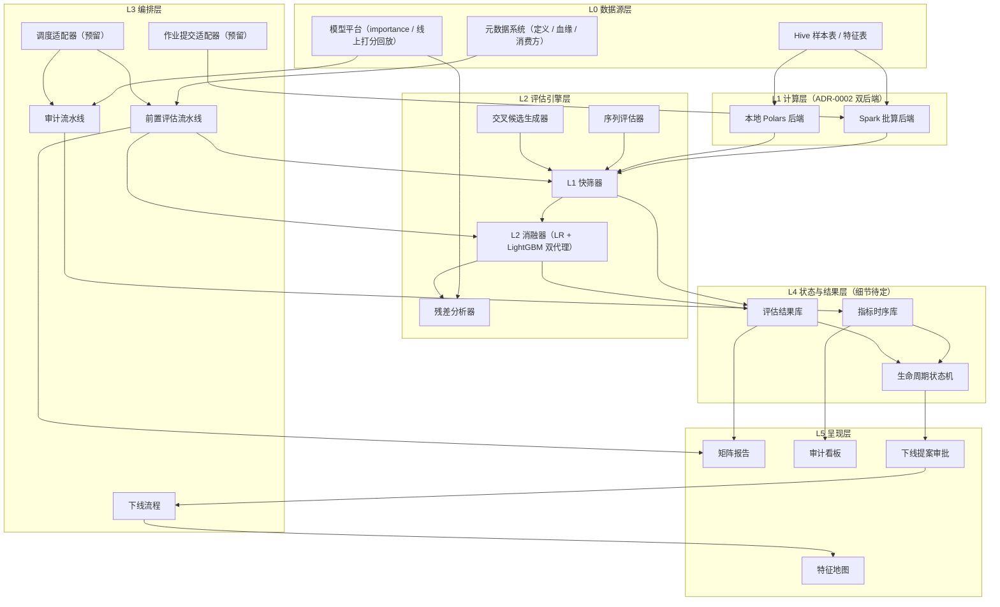
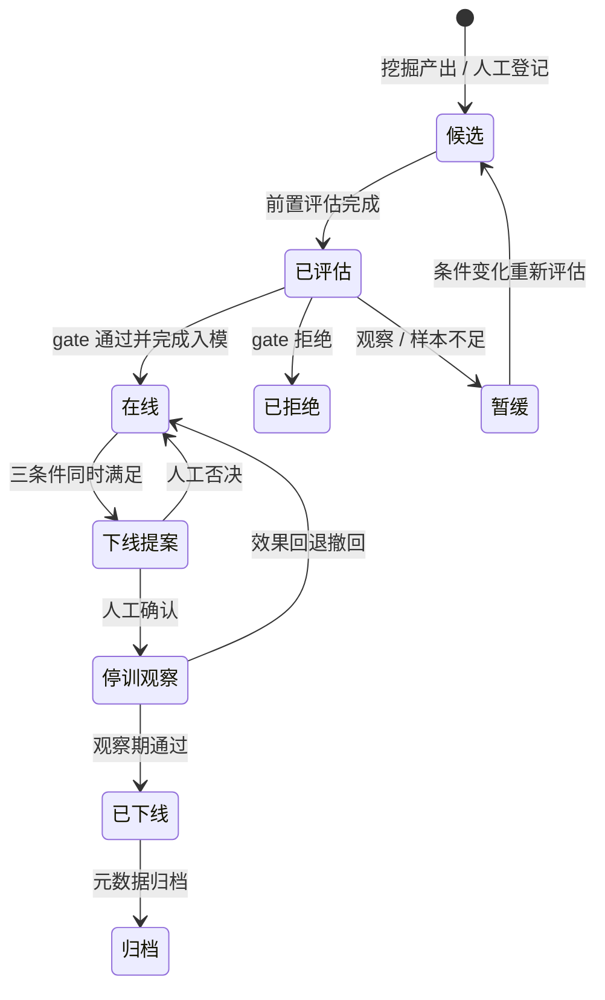

# 特征前置评估与生命周期管理 · 总体方案设计

- 状态：评审中（v0.1，2026-10-24）
- 关联：`CONTEXT.md`（术语表）· ADR-0001（双层评估）· ADR-0002（双后端引擎）· ADR-0003（适配器隔离）· `业界调研附录.md`
- 范围声明：本方案只定义**逻辑架构与过程详细设计**；物理运行架构、调度选型、元数据层细节为**明确推迟项**，集中登记于第 8 章。

## 1. 背景与目标

### 1.1 问题

精排多目标模型群（CTR / CVR / 分行业残差模型 / PLTV / IAA / IAP）特征规模大，当前存在三个缺口：

1. 特征是否值得入模缺乏系统性前置判断，单看特征分布无法回答「加入后模型是否变好」；
2. 原始数据是否值得加工、加工成什么类型特征，缺乏方法化的判断依据；
3. 特征上线后缺乏有效性审计与下线机制，特征集只增不减。

### 1.2 目标：三大能力

| 能力 | 回答的问题 | 方案位置 |
|---|---|---|
| 前置评估 | 这个特征值得入模吗？ | 第 3 章（L1 快筛 + L2 增量，ADR-0001） |
| 特征挖掘 | 这块数据值得加工成什么类型的特征？ | 第 4 章 |
| 生命周期管理 | 什么条件能上线？上线后有效吗？何时下线？ | 第 5 章 |

### 1.3 定位

长期项目「广告特征工程能力与自我提升项目」的工程落地。终局为企业内部平台服务（调度 + 特征地图 + 团队自助使用），按第 7 章分期演进；本阶段产出为方案与逻辑架构，不落代码。

## 2. 总体逻辑架构

### 2.1 分层图



### 2.2 模块职责

| 层 | 模块 | 职责 | 输入 | 输出 |
|---|---|---|---|---|
| L1 | Spark 批算后端 | 生产规模（100w/1000w 可配置）指标计算 | Hive 表 + 特征/标签声明 | 指标结果表 |
| L1 | 本地 Polars 后端 | 采样/调试/小样本分析，口径与 Spark 后端互校 | 本地样本文件 | 同上 |
| L2 | L1 快筛器 | 全部纯统计指标（3.1） | 特征列 + label 列 | L1 指标与等级 |
| L2 | L2 消融器 | 双代理模型加/去特征对照实验（3.2） | 样本 + 现有特征集 + 候选 | ΔAUC/GAUC/LogLoss + CI |
| L2 | 残差分析器 | 候选特征对线上模型残差的解释力（3.2.4） | 线上打分 + label + 特征 | 残差指标 |
| L2 | 序列评估器 | 序列特征三层拆解（3.3） | 序列列 + 候选侧信息 | 统计代理指标 / 探针指标 |
| L2 | 交叉候选生成器 | 受控生成交叉候选（3.4.1） | importance + 特征元数据 | 交叉候选清单（≤500/轮） |
| L3 | 前置评估流水线 | 编排 挖掘/人工候选 → L1 → L2 → 报告 → gate | 候选清单 | 矩阵报告 + gate 结论 |
| L3 | 审计流水线 | 编排 日 PSI / 周 importance / 月全量重算 | 在线特征集 | 指标时序 + 审计报告 |
| L3 | 下线流程 | 编排 提案→停训观察→摘除→归档 | 下线提案（自动生成） | 状态流转 + 归档记录 |
| L4 | 指标时序库 | 存储全量在线特征监控指标时序 | 审计流水线产物 | 时序查询 |
| L4 | 生命周期状态机 | 特征状态权威记录（5.1） | 状态迁移事件 | 当前状态 + 历史 |
| L4 | 评估结果库 | 存储每次前置评估的 L1/L2 结果 | 评估流水线产物 | 矩阵报告数据源 |
| L5 | 矩阵报告 / 审计看板 / 特征地图 / 提案审批 | 呈现与人工决策入口 | L4 数据 | 报告页面 |

### 2.3 核心数据流

1. **前置评估流**：候选（挖掘产出或人工登记）→ L1 快筛（过滤约 80% 无价值候选）→ L2 消融 + 残差分析 → 矩阵报告 → gate 判定 → 入模提案。
2. **审计流**：在线特征集 + 样本表 → 日 PSI / 周 importance 回传 / 月全量 L1 重算 → 指标时序库 → 审计看板 → 下线提案（三条件自动判定）。
3. **下线闭环**：下线提案 → 人工审批 → 停止进入新训练样本 → 观察一个完整训练周期 → 摘除 → 归档 + 特征地图更新。

触发模式：审计类=定时；评估类=事件（候选提交）；下线流程=步骤依赖驱动。调度适配器统一承接三类触发（选型待定，见第 8 章）。

## 3. 前置评估详细设计

### 3.1 L1 快筛（纯统计，不训练任何模型）

#### 3.1.1 指标族

| 组 | 指标 | 定义 | 离散特征 | 连续特征 |
|---|---|---|---|---|
| 区分度 | IV | 分桶后 Σ(pos%−neg%)·ln(pos%/neg%) | 直接按类别分桶 | 等频分桶 |
| 区分度 | KS | 累积正负样本分布最大差 | 按桶累积 | 等频分桶 |
| 区分度 | 单特征 AUC | 特征值对 label 的排序能力 | 类别按 target rate 排序（OOF target encoding，防泄漏） | 直接用原值 |
| 区分度 | 互信息 | I(feature; label) | 离散直接 / 连续分桶后 | 同左 |
| 稳定性 | PSI | 按天分片 vs 基期的分布漂移 | 同上 | 同上 |
| 稳定性 | 时间分片 AUC 衰减 | 评估窗口首日 vs 末日单特征 AUC 差 | 同上 | 同上 |
| 质量 | 缺失率 / 覆盖率 / 单值占比 | 分布健康度 | — | — |
| 质量 | 训练/推理 skew | 离线样本分布 vs 线上回流分布（若可取） | 可选 | 可选 |
| Lift | 分桶 label rate lift | 各桶转化率 / 全局转化率 | 同上 | 同上 |
| Lift | 趋势单调性 | 桶序 vs 桶转化率的 Spearman 相关 | 同上 | 同上 |

#### 3.1.2 分桶自适应规则

核心约束：**每桶正样本 ≥ 50（硬下限）/ 100（理想）**，否则桶级转化率置信区间过宽，Lift 全是噪声。

- 桶数 `k = clamp(floor(正样本总数 / 100), 3, 10)`；桶内正样本 < 50 时自动合并相邻桶。
- 正样本总数 < 300：标记「样本不足，建议累积更长窗口」，不硬拒。
- 连续特征等频分桶；离散高基数先按频次聚 top-N + other（N 使累计覆盖 ≥ 95% 或 N ≤ 100）。
- 缺失作为独立箱参与 IV/Lift 计算（缺失本身可能是信号）。

经验参照表（默认配置，按 label 覆写）：

| 场景 | 正样本率 | 样本量 | 正样本 | k |
|---|---|---|---|---|
| CTR | ~5% | 100w | 5w | 10 |
| CVR | ~1% | 1000w | 10w | 10 |
| 低频 CVR | 0.1% | 1000w | 1w | 10（边界） |
| 深度转化（IAP/PLTV） | 0.01% | 1000w | 1000 | 10，需合并小桶 |
| 同上 | 0.01% | 100w | 100 | 3 桶起 + 「样本不足」标注 |

#### 3.1.3 gate 阈值（默认值，全部可按 label 覆写）

| 指标 | 通过 | 观察 | 拒绝 |
|---|---|---|---|
| IV | [0.02, 0.5] | (0.5, ∞) 转人工审查（疑似泄漏/单桶过拟合） | < 0.02 |
| 单特征 AUC 偏移 | ≥ 0.02 | [0.005, 0.02) | < 0.005 |
| 7 天 PSI | < 0.1 | [0.1, 0.25) | ≥ 0.25 |
| 缺失率 | < 5%，或缺失箱 IV ≥ 0.02 | [5%, 20%) | ≥ 20% 且缺失箱无区分度 |
| Lift 单调性 | Spearman p < 0.05 或有业务解释 | 边缘显著 | 非单调且无解释 |

L1 结论等级：`通过 / 观察 / 拒绝 / 疑似泄漏（转人工）/ 样本不足`。只有「通过」进入 L2。

### 3.2 L2 增量评估

#### 3.2.1 代理模型

- **LR + LightGBM 双代理**：LR 对齐线性效应，LightGBM 捕非线性与交互；两个都跑、都报告。
- 数据 ≤ 500w 采样后本地训练；更大规模走 Spark 路径（预留，对齐 ADR-0002）。
- 报告必须标注：代理模型与线上精排模型（深度模型）的结构差异，结论带此折扣。

#### 3.2.2 消融协议

- **时间外推验证**：train = 窗口前 n−1 天，valid = 第 n 天（防时间泄漏）；可配置滚动多窗。
- 对照：基线组（现有特征集）vs 实验组（+候选特征），同配置训练。
- 指标：ΔAUC / ΔGAUC / ΔLogLoss + **paired bootstrap 95% CI**（B=1000，同一 valid 集上配对重采样）。
- 判定：Δ ≥ 0 且 CI 下界 > −ε（ε 默认 0.0005，可配置）→ 建议入模。

#### 3.2.3 多目标策略

主目标（特征声明主要服务的 1~2 个模型）必跑 L2；L1 矩阵中表现最好的其余 1~2 个目标加跑。残差模型与主模型同构处理：每模型一列，label 从各自样本表配置读取。

#### 3.2.4 残差分析（标准能力，依赖线上打分回放）

1. 取线上模型对评估样本的离线打分 p_online，与真实 label 计算残差 r（经校准）。
2. 计算候选特征对 r 的单特征 AUC、残差分桶 Lift。
3. 代理模型以 r 为目标做加/去特征消融。
4. 判定：r 上仍有区分度 → 线上模型缺这块信息 → 强支持入模；r 上无区分度但 L1 强 → 可能线上模型已通过其他特征覆盖，入模优先级下调。

### 3.3 序列特征评估（三层拆解）

输入形态声明：ID 序列 / 类目序列 / 定长 embedding 三种均支持（登记于特征元数据）。

| 层 | 手段 | 归属 |
|---|---|---|
| ① 统计代理 | 序列长度分布、空序列占比、top-K 元素覆盖率、元素新近度；**target-aware 统计**：用户序列与当前候选的类目/行业命中次数、最近命中位置倒数、时间加权命中 | L1，按 3.1 走 |
| ② 压缩探针 | 元素编码（target encoding 或复用现有 item embedding）→ mean/sum/max pooling 成定长向量 | L2 入口，走单特征 AUC + 消融 |
| ③ 信息增量 | 条件互信息 / 残差 AUC：在「已有统计特征集」之上评估序列特征剩余增量 | L2 |

判定要点：若统计代理已解释殆尽而探针无增量，说明不需要序列建模，统计特征即可入模。**时间切点校验为硬 gate**：序列快照时间戳必须早于样本时间戳。

### 3.4 交叉特征评估（三段式，控制组合爆炸）

1. **候选生成**（每轮上限 500）：① 已入模特征 importance top-K（K≈20）× 候选特征；② 同域交叉（user×item、行业×创意）；③ 业务规则指定。
2. **L1 快筛**：交叉列做二维列联 → 当作新离散特征算 IV / 互信息（Spark 上一次 join + group by），阈值同 3.1。
3. **L2 增量**：代理模型加/不加交叉特征对照。**加严判定**：交叉特征增量必须显著超过其父特征已解释的部分；若「加交叉同时去父特征」不掉点，标记「交叉可替代父特征」。
4. Friedman H-statistic 作为交互解释备选工具；AutoCross 式 beam search 全自动搜索列入二期调研（见附录 §3、§5）。

### 3.5 矩阵报告与主目标

- 行 = 候选特征，列 = 目标模型（CTR / CVR / 残差×N / PLTV / IAA / IAP，同构处理）。
- 每格：L1 等级 + L2 ΔAUC（95% CI）+ 结论图标（✅ 建议 / ⚠️ 观察 / ❌ 拒绝 / ⊘ 样本不足）。
- **gate 按主目标列判定，其余列仅参考**——避免「所有列都必须好」误杀只服务特定目标的特征。
- 样本不足列标注状态而非硬拒绝。
- 下钻页：分桶表 / Lift 图 / PSI 时序 / 残差散点 / 时间外推曲线。

## 4. 特征挖掘详细设计

### 4.1 输入与画像

输入：Hive 表 + 字段级抽样画像（抽样 10w 行或全量小表）。画像维度：字段类型、基数、缺失率、时间属性（事件流 vs 快照）、实体键（user / item / industry / creative）、变化频率、与已有特征实体的关联关系。

### 4.2 画像 → 特征类型建议规则表

| 数据画像 | 建议特征类型 | 说明 |
|---|---|---|
| 主键 + 时间戳的事件表 | 窗口聚合 | 1/7/30d 计数、比率、去重数 |
| 快照表 | 当前值 + 变化率 | 相邻快照差分 |
| 高基数 ID（>1000） | target encoding / 计数统计 / 嵌入引用 | TE 必须 OOF 防泄漏 |
| 低基枚举（≤50） | 直接入模 + 交叉候选 | 交叉走 3.4 |
| 行为流（时序事件） | 序列特征 | 走 3.3 |
| 连续数值 | 分箱 / 统计变换 / 比率组合 | 分箱走 3.1 自适应 |
| 多实体关联表 | 关联侧聚合 | 按实体键 join 后统计 |

### 4.3 产出与衔接

产出候选清单：`{字段/表, 建议特征类型, 预估加工成本（点查 / 窗口聚合 / 序列回溯）, 优先级}`，直接推入前置评估流水线（第 2 章数据流①）。

范围分期：V1 做存量特征表画像（找二次加工机会）；V2 扩展新原始表。AutoFE（OpenFE / Featuretools 等）与 LLM 建议并行调研、后置接入（遵循长期项目「先建模后 Agent」原则）。

## 5. 特征生命周期设计

### 5.1 状态机



### 5.2 上线 gate（硬门槛，全部通过才可入模）

1. L1 快筛通过（3.1.3）；
2. L2 增量非负：ΔAUC ≥ 0 且 CI 下界 > −ε；
3. 稳定性：连续 7 天 PSI < 0.1；
4. 覆盖率 ≥ 95%；
5. （可选）训练/推理一致率 ≥ 99.9%（依赖线上回流，可测时生效）。

### 5.3 监控与审计节奏

| 频率 | 内容 | 数据来源 |
|---|---|---|
| 日 | PSI、覆盖率、缺失率巡检 | 样本表 + 在线特征 |
| 周 | importance 回传入库 | 模型平台（适配器） |
| 月 | 审计报告：importance 分位及趋势 / PSI 漂移 / 覆盖率 / 与保留特征冗余度（相关 + 互信息）/ L1 指标重算对比基线 | 审计流水线 |

### 5.4 下线评估

**三条件同时满足才进入下线提案**（自动判定生成提案，不自动执行）：

1. 连续 3 个月度审计 importance 位于全体后 10%；
2. 去特征消融不降点（ΔAUC CI 下界 > −ε）；
3. 高冗余：与保留特征 |ρ| > 0.9 或互信息高于阈值。

**下线流程**：提案 → 人工审批 → 停止进入新训练样本 → 观察一个完整训练周期（线上指标 + 再训练对照）→ 摘除 → 归档 + 特征地图更新。观察期内效果回退则撤回至在线。

## 6. 适配器接口契约（ADR-0003）

本方案只定契约；所有实现推迟到对应分期。契约为 Python Protocol 风格签名。

### 6.1 SparkJobSubmitAdapter（预留，由使用方补齐实现）

```
submit(spec: JobSpec) -> JobHandle
status(handle: JobHandle) -> PENDING | RUNNING | SUCCEEDED | FAILED
logs(handle: JobHandle) -> LogStream
cancel(handle: JobHandle)

JobSpec = {
  entry: 算子入口,
  params: {hive_tables, sample_size, feature_list, label_def, window},
  resources: {cores, memory},
  pyenv: 打包依赖引用（按"Python 可打包任意依赖"约定）
}
```

### 6.2 ScheduleAdapter（预留，选型待定，见第 8 章）

```
register(spec: TriggerSpec) -> TriggerId
unregister(id: TriggerId)
fire_now(id: TriggerId)

TriggerSpec = {job: JobRef, mode: cron | event | dependency, cron?: str, deps?: [TriggerId]}
```

### 6.3 MetadataAdapter（只读对接已有元数据系统）

```
feature_definitions(filter: Filter) -> [FeatureDef{ id, name, owner, lineage, consumers }]
lineage(feature_id) -> Lineage
```

### 6.4 ImportanceFeedAdapter

```
fetch(model_id, version?) -> [ {feature_id, gain, split} ]
versions(model_id) -> [version]
```

### 6.5 OnlineScoreAdapter

```
fetch(model_id, sample_window) -> [ {sample_key, p} ]   # 线上模型离线回放打分
```

### 6.6 ReportSinkAdapter

```
publish(report: Report) -> url
notify(audience: Audience)
```

## 7. 分期路线图

| 阶段 | 范围 | 交付物 | 验收 | 前置条件 |
|---|---|---|---|---|
| V1 单模型端到端 | CTR 模型 + 一张样本表；L1 全指标 + L2 双代理消融 + 残差分析；单列矩阵报告（HTML/MD）；YAML 雏形登记（特征 + 评估结果）；适配器以本地实现顶替 | 可运行的前置评估工具链 + 首批报告 | 对 ≥ 10 个真实候选特征产出报告，与模型同学评审结论一致性核对 | 无 |
| V2 多目标与监控 | 矩阵全列；调度接入（定时 + 事件）；生命周期状态机正式化；审计流水线（日/周/月）；挖掘 V1（存量表画像） | 审计看板 + 状态机服务 | 全量在线特征纳入监控与月度审计 | 调度适配器实现、importance 回传打通 |
| V3 平台化 | Web 呈现（特征地图/看板/审批）；下线闭环全流程；AutoFE 候选生成评估接入 | 团队自助平台 | 团队日常自助使用，下线闭环跑通首例 | 元数据层细节定案（第 8 章 #3） |

## 8. 待定决策清单

| # | 决策点 | 影响范围 | 状态 |
|---|---|---|---|
| 1 | 调度系统选型 | L3 编排层 | 待定；触发需求已明确（定时/事件/依赖三类） |
| 2 | 物理运行架构 | 全局 | 待定，后续单独讨论 |
| 3 | 元数据层主数据关系（复用已有系统 vs 自建） | L4 | 待定；倾向复用已有系统为主数据、本系统只建评估与状态 |
| 4 | CVR 归因窗口口径 | L1/L2 样本构造 | 待定（业务口径） |
| 5 | Spark 提交 API 与依赖打包细节 | 6.1 契约实现 | 预留，使用方补齐 |
| 6 | 残差模型 label 精确语义验证 | 3.5 / 3.2.3 | 按同构假设设计，需内部确认 |
| 7 | 内部系统摸底（元数据/模型平台接口细节） | 全部适配器实现 | 待供料 |
| 8 | ε 及各阈值业务校准 | gate 判定 | V1 期间以默认值运行后校准 |
