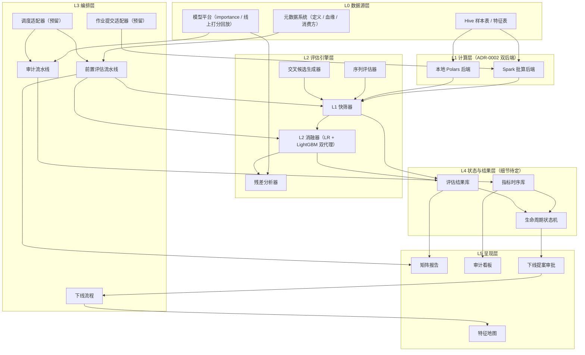
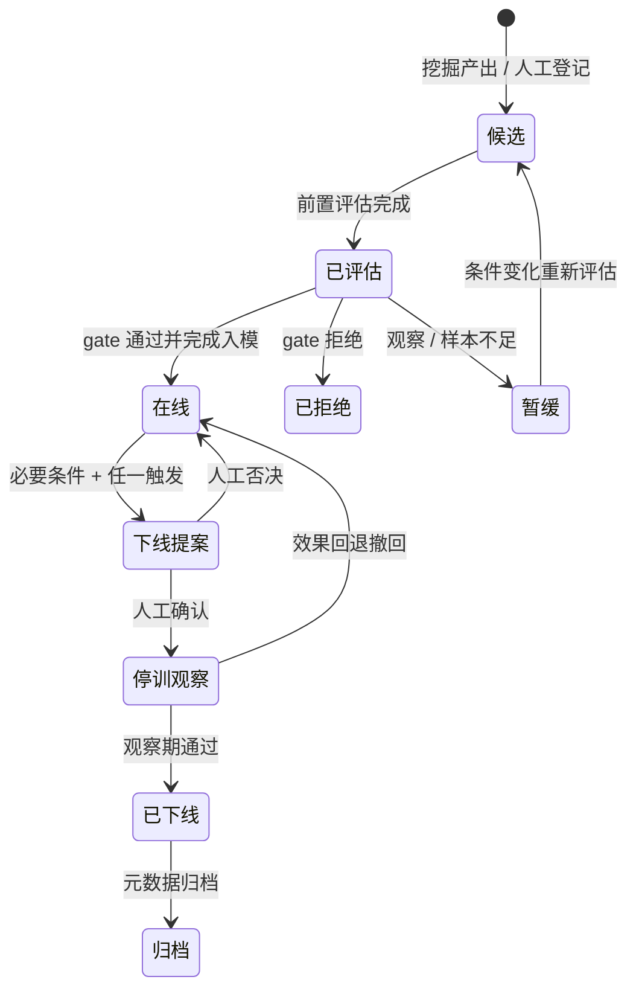

# 特征前置评估与生命周期管理 · 总体方案设计

- 状态：评审中（v0.2，2026-10-25；v0.1 原文存档于 `archive/总体方案设计-v0.1.md`，改动见第 9 章；评审问题清单见 `评审问题清单-v0.2.md`）
- 关联：`CONTEXT.md`（术语表）· ADR-0001（双层评估）· ADR-0002（双后端引擎）· ADR-0003（适配器隔离）· ADR-0004（入模优效、下线非劣效）· `业界调研附录.md` · 原型代码 `feval/`（见仓库 README）
- 范围声明：本方案只定义**逻辑架构与过程详细设计**；物理运行架构、调度选型、元数据层细节为**明确推迟项**，集中登记于第 8 章。

## 1. 背景与目标

### 1.1 问题

精排多目标模型群（CTR / CVR / 分行业残差模型 / PLTV / IAA / IAP）特征规模大，当前存在三个缺口：

1. 特征是否值得入模缺乏系统性前置判断，单看特征分布无法回答「加入后模型是否变好」；
2. 原始数据是否值得加工、加工成什么类型特征，缺乏方法化的判断依据；
3. 特征上线后缺乏有效性审计与下线机制，特征集只增不减。

### 1.2 目标：三大能力

| 能力 | 回答的问题 | 方案位置 |
|---|---|---|
| 前置评估 | 这个特征值得入模吗？ | 第 3 章（L1 快筛 + L2 增量，ADR-0001） |
| 特征挖掘 | 这块数据值得加工成什么类型的特征？ | 第 4 章 |
| 生命周期管理 | 什么条件能上线？上线后有效吗？何时下线？ | 第 5 章 |

### 1.3 定位

长期项目「广告特征工程能力与自我提升项目」的工程落地。终局为企业内部平台服务（调度 + 特征地图 + 团队自助使用），按第 7 章分期演进；本仓库与母项目的边界 V2 之后再定（第 8 章 #9）。v0.1 只产出方案；v0.2 起并行建设本地原型（V0，见 7.1），用带真值的 mock 数据验证判据，代码随后上传公司环境、换真实数据运行。

## 2. 总体逻辑架构

### 2.1 分层图



### 2.2 模块职责

| 层 | 模块 | 职责 | 输入 | 输出 |
|---|---|---|---|---|
| L1 | Spark 批算后端 | 生产规模（100w/1000w 可配置）指标计算 | Hive 表 + 特征/标签声明 | 指标结果表 |
| L1 | 本地 Polars 后端 | 采样/调试/小样本分析，口径与 Spark 后端互校 | 本地样本文件 | 同上 |
| L2 | L1 快筛器 | 全部纯统计指标（3.1） | 特征列 + label 列 | L1 指标与等级 |
| L2 | L2 消融器 | 双代理模型加/去特征对照实验 + 通过者联合确认（3.2） | 样本 + 现有特征集 + 候选 + 口径卡 | ΔAUC/GAUC/LogLoss + 聚类 bootstrap CI |
| L2 | 残差分析器 | 候选特征对线上模型残差的解释力（3.2.4） | 线上打分 + label + 特征 | 残差指标 |
| L2 | 序列评估器 | 序列特征三层拆解（3.3） | 序列列 + 候选侧信息 | 统计代理指标 / 探针指标 |
| L2 | 交叉候选生成器 | 受控生成交叉候选（3.4.1） | importance + 特征元数据 | 交叉候选清单（≤500/轮） |
| L3 | 前置评估流水线 | 编排 挖掘/人工候选 → L1 → L2 → 报告 → gate | 候选清单 | 矩阵报告 + gate 结论 |
| L3 | 审计流水线 | 编排 日 PSI / 周 importance / 月全量重算 | 在线特征集 | 指标时序 + 审计报告 |
| L3 | 下线流程 | 编排 提案→停训观察→摘除→归档 | 下线提案（自动生成） | 状态流转 + 归档记录 |
| L4 | 指标时序库 | 存储全量在线特征监控指标时序 | 审计流水线产物 | 时序查询 |
| L4 | 生命周期状态机 | 特征状态权威记录（5.1） | 状态迁移事件 | 当前状态 + 历史 |
| L4 | 评估结果库 | 存储每次前置评估的 L1/L2 结果 | 评估流水线产物 | 矩阵报告数据源 |
| L5 | 矩阵报告 / 审计看板 / 特征地图 / 提案审批 | 呈现与人工决策入口 | L4 数据 | 报告页面 |

### 2.3 核心数据流

1. **前置评估流**：候选（挖掘产出或人工登记）→ L1 快筛（过滤约 80% 无价值候选）→ L2 消融 + 残差分析 + 通过者联合确认 → 矩阵报告 → gate 判定 → 入模提案。
2. **审计流**：在线特征集 + 样本表 → 日 PSI / 周 importance 回传 / 月全量 L1 重算 → 指标时序库 → 审计看板 → 下线提案（必要条件 + 任一触发，自动判定）。
3. **下线闭环**：下线提案 → 人工审批 → 停止进入新训练样本 → 观察一个完整训练周期 → 摘除 → 归档 + 特征地图更新。

触发模式：审计类=定时；评估类=事件（候选提交）；下线流程=步骤依赖驱动。调度适配器统一承接三类触发（选型待定，见第 8 章）。

## 3. 前置评估详细设计

### 3.0 目标口径卡（评估的前置条件，v0.2 新增）

矩阵报告的每一列（一个目标模型）先有一张口径卡，评估引擎只按口径卡取数、切分和选指标；口径卡没填完的列不进入评估。

| 字段 | 含义 | 用在哪里 |
|---|---|---|
| label 与 label 类型 | 二分类 / 连续 / 零膨胀连续 | 指标族（3.1.1 / 3.1.4） |
| 样本空间 | 曝光 / 点击 / 激活 / 付费 | 样本表口径，CVR 类必须写明 |
| 成熟期 | label 从事件发生到稳定所需天数（归因窗口、LTV 窗口） | 时间切分：valid 日 ≤ 数据末日 − 成熟期（3.2.2） |
| 负采样率 | 负样本保留比例 | LogLoss 与校准类指标需按采样率还原 |
| 分组键 | user 或 request | 聚类 bootstrap 与 GAUC（3.2.2） |
| 适用人群 | 该模型服务的样本子集（如某行业的广告） | 评估前先按它过滤样本 |
| 主指标 | AUC / GAUC / 归一化 Gini 等 | L2 判定所用指标 |

当前已知情况（未确认项统一登记在第 8 章）：

| 目标 | label 类型 | 样本空间 | 成熟期 | 其余字段 |
|---|---|---|---|---|
| CTR | 二分类 | 曝光 | ≈ 0 天 | 待确认 |
| CVR | 二分类 | 点击（待确认） | 归因窗口（#4） | 待确认 |
| 分行业残差 ×N | 待确认（#6） | 待确认 | 待确认 | 适用人群 = 各行业 |
| PLTV | 待确认（通常为连续值，#10） | 待确认 | LTV 窗口 | 待确认 |
| IAA / IAP | 待确认（#10） | 待确认 | 待确认 | 待确认 |

### 3.1 L1 快筛（纯统计，不训练任何模型）

#### 3.1.1 指标族

| 组 | 指标 | 定义 | 离散特征 | 连续特征 |
|---|---|---|---|---|
| 区分度 | IV | 分桶后 Σ(pos%−neg%)·ln(pos%/neg%) | 直接按类别分桶 | 等频分桶 |
| 区分度 | KS | 累积正负样本分布最大差 | 按桶累积 | 等频分桶 |
| 区分度 | 单特征 AUC | 特征值对 label 的排序能力 | 两折 OOF：一折的桶转化率定桶序，另一折算 AUC（按分组键分折） | 同左，先分桶（v0.1 用原值，U 型特征 AUC≈0.5 会被误拒） |
| 区分度 | 互信息 | I(feature; label) | 离散直接 / 连续分桶后 | 同左 |
| 稳定性 | PSI | 按天分片 vs 基期的分布漂移 | 同上 | 同上 |
| 稳定性 | 时间分片 AUC 衰减 | 评估窗口首日 vs 末日单特征 AUC 差 | 同上 | 同上 |
| 质量 | 缺失率 / 覆盖率 / 单值占比 | 分布健康度 | — | — |
| 质量 | 训练/推理 skew | 离线样本分布 vs 线上回流分布（若可取） | 可选 | 可选 |
| 质量 | 时点正确性 | 特征快照时间早于样本时间；窗口聚合不含样本自身事件 | 硬 gate | 硬 gate |
| Lift | 分桶 label rate lift | 各桶转化率 / 全局转化率 | 同上 | 同上 |
| Lift | 趋势单调性 | 桶序 vs 桶转化率的 Spearman 相关（只做描述） | 同上 | 同上 |

以上是二分类 label 的口径，连续型 label 见 3.1.4。缺失率只在**特征定义域**内计算（见 CONTEXT.md）：定义域外是结构性缺失，不计入缺失率，但缺失箱照常参与 IV 与 Lift。

#### 3.1.2 分桶自适应规则

核心约束：**每桶正样本 ≥ 50（硬下限）/ 100（理想）**，否则桶级转化率置信区间过宽，Lift 全是噪声。

- 桶数 `k = clamp(floor(正样本总数 / 100), 3, 10)`；桶内正样本 < 50 时自动合并相邻桶。
- 正样本总数 < 300：标记「样本不足，建议累积更长窗口」，不硬拒。
- 连续特征等频分桶；离散高基数先按频次聚 top-N + other（N 使累计覆盖 ≥ 95% 或 N ≤ 100）。
- 缺失作为独立箱参与 IV/Lift 计算（缺失本身可能是信号）。

经验参照表（默认配置，按 label 覆写）：

| 场景 | 正样本率 | 样本量 | 正样本 | k |
|---|---|---|---|---|
| CTR | ~5% | 100w | 5w | 10 |
| CVR | ~1% | 1000w | 10w | 10 |
| 低频 CVR | 0.1% | 1000w | 1w | 10（边界） |
| 深度转化（IAP/PLTV） | 0.01% | 1000w | 1000 | 10，需合并小桶 |
| 同上 | 0.01% | 100w | 100 | 3 桶起 + 「样本不足」标注 |

#### 3.1.3 gate 阈值（默认值，全部可按 label 覆写）

| 指标 | 通过 | 观察 | 拒绝 |
|---|---|---|---|
| IV | [0.02, 0.5] | (0.5, ∞) 转人工审查（疑似泄漏/单桶过拟合） | < 0.02 |
| 单特征 AUC 偏移 | ≥ 0.02 | [0.005, 0.02) | < 0.005 |
| 7 天 PSI | < 0.1 | [0.1, 0.25) | ≥ 0.25 |
| 缺失率（定义域内） | < 5%，或缺失箱 IV ≥ 0.02 | [5%, 20%) | ≥ 20% 且缺失箱无区分度 |

v0.1 的「Lift 单调性」一行已删除：单调性要求来自 LR 评分卡（线性模型 + 监管可解释），GBDT/DNN 不需要，U 型特征会被误拒；单调性改为只做描述。

L1 结论等级：`通过 / 观察 / 拒绝 / 疑似泄漏（转人工）/ 样本不足`。只有「通过」进入 L2。

**合成规则**（v0.2 新增，按顺序取第一个命中的等级）：

1. 正样本 < 300 → 样本不足；
2. IV > 0.5 → 疑似泄漏（转人工，并复核时点正确性）；
3. 区分度不达标（IV < 0.02 且 AUC 偏移 < 0.005），或 PSI ≥ 0.25，或缺失率 ≥ 20% 且缺失箱无区分度 → 拒绝；
4. 区分度只到观察带（IV < 0.02 且 AUC 偏移 ∈ [0.005, 0.02)），或 PSI ∈ [0.1, 0.25)，或缺失率 ∈ [5%, 20%) 且缺失箱无区分度 → 观察；
5. 其余 → 通过（IV 与 AUC 偏移任一达标即可）。

多重比较：每批候选混入负对照（噪声探针），阈值按负对照的误放率校准（7.1），不靠单个 p 值。

#### 3.1.4 连续型 label 的指标族（v0.2 新增，V2 实现）

PLTV、IAA 收入等金额型 label 不能套用 IV/KS/AUC：

- L1：Spearman ρ、分桶均值 Lift（各桶均值 / 全局均值）、归一化 Gini；PSI 与缺失率规则不变。
- 零膨胀（大部分样本为 0）：拆成「是否发生」（二分类，走 3.1.1）与「发生后的金额」（连续，只在正样本上算）两段。
- L2：主指标改为归一化 Gini 或 log1p 尺度的 ΔRMSE，判定规则同 3.2.2。

### 3.2 L2 增量评估

#### 3.2.1 代理模型

- **LR + LightGBM 双代理**：LR 对齐线性效应，LightGBM 捕非线性与交互；两个都跑、都报告。
- **合并口径**（v0.2，依据 7.1 校准）：任一代理满足优效即建议入模；两个代理的 CI 上界都 < 0 才判有害。LR 对线性弱信号方差小、检出率高；LightGBM 能看到 LR 看不到的非线性（如 U 型）。代价是零增量特征的误放率上界从单代理的 2.5% 升到 5%（两个单侧检验取并），由每批负对照实测核对。反过来，非劣效类判断（下线 5.4、共享底座的次目标约束 3.2.3、交叉替代父特征 3.4）要求两个代理都满足。
- 数据 ≤ 500w 采样后本地训练；更大规模走 Spark 路径（预留，对齐 ADR-0002）。
- 报告必须标注：代理模型与线上精排模型（深度模型）的结构差异，结论带此折扣。代理模型没有 ID embedding，LightGBM 会把用户级特征当作用户 ID，记住持久的用户效应（mock 上用户级常量随机数误放 17%，7.1 #4）；线上模型若有用户 ID embedding，这部分增量早已学到。用户粒度候选的结论要用残差分析（3.2.4）复核，判据待定（第 8 章 #13）。

#### 3.2.2 消融协议

- **时间外推验证**：valid = 数据末日 − 成熟期（口径卡），train = valid 之前的天；label 未成熟的天不参与评估（v0.1 直接取第 n 天，CVR/IAP/PLTV 会系统性少计转化）。可配置滚动多窗。
- 对照：基线组（现有特征集）vs 实验组（+候选特征），同配置训练。
- 指标：ΔAUC / ΔGAUC / ΔLogLoss + **按分组键的 paired bootstrap 95% CI**（B=1000）：以口径卡的分组键（user 或 request）为单位重采样，同组样本同进同出；实现用 Poisson bootstrap（每组独立抽 Poisson(1) 权重，Spark 上可逐行生成）。
- 判定（**优效**，ADR-0004）：主指标 Δ 的 CI 下界 > δ_min → 建议入模；CI 上界 < 0 → 有害；其余 → 无显著增量。双代理的合并口径见 3.2.1。δ_min 默认 0，按负对照误放率校准（7.1）。bootstrap 只覆盖验证集的抽样波动，不覆盖训练随机性，δ_min 与滚动多窗一致性是兜底。
- **通过者联合确认**（v0.2 新增）：同批各自通过的候选，按单独增量从大到小逐个加入，在已接收集合之上仍满足优效才保留，剔除彼此冗余者。

#### 3.2.3 多目标策略

主目标（特征声明主要服务的 1~2 个模型）必跑 L2；L1 矩阵中表现最好的其余 1~2 个目标加跑。残差模型与主模型同构处理：每模型一列，label 与样本口径从各自的口径卡读取（3.0）。若多个目标共享底座（MMoE/PLE 类，特征进入共享 embedding），次目标列追加非劣效约束（CI 下界 > −ε），防止负迁移；模型结构待确认（第 8 章 #11）。

#### 3.2.4 残差分析（标准能力，依赖线上打分回放）

1. 取线上模型对评估样本的离线打分 p_online，先在 train 上做 Platt 校准。
2. 以校准后的 logit(p_online) 作 init_score（LR 用 offset），只用候选特征在真实 label 上继续拟合，比较「线上分 + 候选」与「线上分」的 Δ（CI 同 3.2.2）。logloss 下的梯度提升本来就是在残差上拟合，这比直接回归残差 r 更严谨，也自动处理了校准。
3. 描述用：候选特征各桶的平均残差（即分桶校准偏差）。v0.1 的「对 r 算单特征 AUC」不成立：r 是连续值。
4. 判定：线上分之上仍有增量 → 线上模型缺这块信息 → 强支持入模；没有增量但 L1 强 → 可能已被线上模型通过其他特征覆盖，入模优先级下调。

### 3.3 序列特征评估（三层拆解）

输入形态声明：ID 序列 / 类目序列 / 定长 embedding 三种均支持（登记于特征元数据）。

| 层 | 手段 | 归属 |
|---|---|---|
| ① 统计代理 | 序列长度分布、空序列占比、top-K 元素覆盖率、元素新近度；**target-aware 统计**：用户序列与当前候选的类目/行业命中次数、最近命中位置倒数、时间加权命中 | L1，按 3.1 走 |
| ② 压缩探针 | 元素编码（target encoding 或复用现有 item embedding）→ mean/sum/max pooling 成定长向量 | L2 入口，走单特征 AUC + 消融 |
| ③ 信息增量 | 条件互信息 / 残差 AUC：在「已有统计特征集」之上评估序列特征剩余增量 | L2 |

判定要点：若统计代理已解释殆尽而探针无增量，说明不需要序列建模，统计特征即可入模。**时间切点校验为硬 gate**：序列快照时间戳必须早于样本时间戳（v0.2 起对所有特征生效，见 3.1.1 时点正确性）。

### 3.4 交叉特征评估（三段式，控制组合爆炸）

1. **候选生成**（每轮上限 500）：① 已入模特征 importance top-K（K≈20）× 候选特征；② 同域交叉（user×item、行业×创意）；③ 业务规则指定。
2. **L1 快筛**：交叉列做二维列联 → 当作新离散特征算 IV / 互信息（Spark 上一次 join + group by），阈值同 3.1；每轮多达 500 个候选，误放率按负对照校准（3.1.3）。
3. **L2 增量**：基线包含两个父特征，交叉特征按 3.2.2 做优效判定，即增量必须显著超过父特征已解释的部分；若「加交叉同时去父特征」不掉点（非劣效），标记「交叉可替代父特征」。
4. Friedman H-statistic 作为交互解释备选工具；AutoCross 式 beam search 全自动搜索列入二期调研（见附录 §3、§5）。

### 3.5 矩阵报告与主目标

- 行 = 候选特征，列 = 目标模型（CTR / CVR / 残差×N / PLTV / IAA / IAP，同构处理）。
- 每格：L1 等级 + L2 主指标 Δ（95% 聚类 CI）+ 结论图标（✅ 建议 / ⚠️ 观察或无显著增量 / ❌ 拒绝 / ⊘ 样本不足 / 🔍 疑似泄漏）。
- 每批报告附对照检查行：负对照误放数、正对照漏放数（7.1）。
- **gate 按主目标列判定，其余列仅参考**——避免「所有列都必须好」误杀只服务特定目标的特征。
- 样本不足列标注状态而非硬拒绝。
- 下钻页：分桶表 / Lift 图 / PSI 时序 / 残差散点 / 时间外推曲线。

## 4. 特征挖掘详细设计

### 4.1 输入与画像

输入：Hive 表 + 字段级抽样画像（抽样 10w 行或全量小表）。画像维度：字段类型、基数、缺失率、时间属性（事件流 vs 快照）、实体键（user / item / industry / creative）、变化频率、与已有特征实体的关联关系。

### 4.2 画像 → 特征类型建议规则表

| 数据画像 | 建议特征类型 | 说明 |
|---|---|---|
| 主键 + 时间戳的事件表 | 窗口聚合 | 1/7/30d 计数、比率、去重数 |
| 快照表 | 当前值 + 变化率 | 相邻快照差分 |
| 高基数 ID（>1000） | target encoding / 计数统计 / 嵌入引用 | TE 必须 OOF 防泄漏 |
| 低基枚举（≤50） | 直接入模 + 交叉候选 | 交叉走 3.4 |
| 行为流（时序事件） | 序列特征 | 走 3.3 |
| 连续数值 | 分箱 / 统计变换 / 比率组合 | 分箱走 3.1 自适应 |
| 多实体关联表 | 关联侧聚合 | 按实体键 join 后统计 |

### 4.3 产出与衔接

产出候选清单：`{字段/表, 建议特征类型, 预估加工成本（点查 / 窗口聚合 / 序列回溯）, 优先级}`，直接推入前置评估流水线（第 2 章数据流①）。

范围分期：V1 做存量特征表画像（找二次加工机会）；V2 扩展新原始表。AutoFE（OpenFE / Featuretools 等）与 LLM 建议并行调研、后置接入（遵循长期项目「先建模后 Agent」原则）。

### 4.4 误差驱动挖掘（v0.2 新增，V1 之后建设）

4.1–4.3 看的是「数据长什么样」（供给侧）；误差驱动挖掘从「模型缺什么」出发（需求侧）：

1. 用线上打分回放（6.5）算残差，按人群、广告主、行业、创意类型、时段等切片，找出排序能力最差或校准偏差最大的切片；
2. 把切片结论转成「缺什么信息」的假设，再按 4.2 规则表定向找数据源和特征类型；
3. 产出的候选照常走前置评估，并用残差分析（3.2.4）复核该切片是否被补上。

自动切片方法参照 Slice Finder（附录 §5）。

## 5. 特征生命周期设计

### 5.1 状态机



### 5.2 上线 gate（硬门槛，全部通过才可入模）

1. L1 快筛通过（3.1.3）；
2. L2 增量优效：主指标 Δ 的 CI 下界 > δ_min（双代理合并口径见 3.2.1），且通过联合确认（3.2.2，ADR-0004）；
3. 稳定性：连续 7 天 PSI < 0.1；
4. 缺失率：在特征定义域内按 3.1.3 规则判定（v0.1 的「全局覆盖率 ≥ 95%」与 3.1.3 冲突，还会卡死行业专属特征，已删除）；
5. 时点正确性（硬）：特征快照早于样本时间，窗口聚合不含样本自身事件；
6. （可选）训练/推理一致率 ≥ 99.9%（依赖线上回流，可测时生效）。

### 5.3 监控与审计节奏

| 频率 | 内容 | 数据来源 |
|---|---|---|
| 日 | PSI、覆盖率、缺失率巡检 | 样本表 + 在线特征 |
| 周 | importance 回传入库（口径见 6.4 的 method 字段） | 模型平台（适配器） |
| 月 | 审计报告：importance 分位及趋势 / PSI 漂移 / 覆盖率 / 与保留特征冗余度（相关 + 互信息）/ L1 指标重算对比基线 / 特征成本（V1 后接成本账本） | 审计流水线 |

### 5.4 下线评估

**必要条件 + 任一触发**才进入下线提案（自动判定生成提案，不自动执行）：

- 必要条件：去特征消融不降点，即主指标 Δ 的 CI 下界 > −ε（非劣效，ADR-0004），双代理须都满足（与入模的「任一代理优效」对称：任一代理显示有用就不下线）；
- 触发条件（满足其一即启动上述消融）：
  1. 连续 3 个月度审计 importance 位于全体后 10%；
  2. 高冗余：与保留特征 |ρ| > 0.9 或互信息高于阈值；
  3. 成本高：单位增益成本超阈值（V1 后接成本账本，7.2）；
  4. 质量失效：覆盖率骤降、常量化，或 PSI 长期超标且无法修复。

v0.1 要求三条同时满足，其中「高冗余」把噪声特征挡在门外：噪声特征不重要、去掉也不掉点，但和任何保留特征都不相关，永远进不了提案。v0.2 把冗余度降为提案里的解释字段（被谁替代）。

**下线流程**：提案 → 人工审批 → 停止进入新训练样本 → 观察一个完整训练周期（线上指标 + 再训练对照）→ 摘除 → 归档 + 特征地图更新。观察期内效果回退则撤回至在线。

## 6. 适配器接口契约（ADR-0003）

本方案只定契约；所有实现推迟到对应分期。契约为 Python Protocol 风格签名。

### 6.1 SparkJobSubmitAdapter（预留，由使用方补齐实现）

```
submit(spec: JobSpec) -> JobHandle
status(handle: JobHandle) -> PENDING | RUNNING | SUCCEEDED | FAILED
logs(handle: JobHandle) -> LogStream
cancel(handle: JobHandle)

JobSpec = {
  entry: 算子入口,
  params: {hive_tables, sample_size, feature_list, label_def, window},
  resources: {cores, memory},
  pyenv: 打包依赖引用（按"Python 可打包任意依赖"约定）
}
```

### 6.2 ScheduleAdapter（预留，选型待定，见第 8 章）

```
register(spec: TriggerSpec) -> TriggerId
unregister(id: TriggerId)
fire_now(id: TriggerId)

TriggerSpec = {job: JobRef, mode: cron | event | dependency, cron?: str, deps?: [TriggerId]}
```

### 6.3 MetadataAdapter（只读对接已有元数据系统）

```
feature_definitions(filter: Filter) -> [FeatureDef{ id, name, owner, lineage, consumers }]
lineage(feature_id) -> Lineage
```

### 6.4 ImportanceFeedAdapter

```
fetch(model_id, version?) -> [ {feature_id, value, method} ]
versions(model_id) -> [version]

method ∈ {mask_delta_auc, permutation_delta_auc, gain, split, ...}
```

线上精排是深度模型，没有树模型的 gain/split。默认口径为 `mask_delta_auc`：在留出集上把该特征置为默认值后的 AUC 下降，不需要重训。v0.1 的 `{gain, split}` 是树模型字段，趁契约冻结前改掉（ADR-0003）。

### 6.5 OnlineScoreAdapter

```
fetch(model_id, sample_window) -> [ {sample_key, p} ]   # 线上模型离线回放打分
```

### 6.6 ReportSinkAdapter

```
publish(report: Report) -> url
notify(audience: Audience)
```

## 7. 分期路线图

| 阶段 | 范围 | 交付物 | 验收 | 前置条件 |
|---|---|---|---|---|
| V0 本地原型（v0.2 新增） | 带真值的 mock 数据；L1 全指标 + 合成规则；L2 双代理 + 聚类 bootstrap + 残差分析 + 联合确认；矩阵报告（MD）；评估器校准脚本 | `feval/` 包 + mock 矩阵报告 + 校准报告 | 校准报告中负对照误放率 ≤ 5%、正对照全部通过（7.1） | 无 |
| V1 单模型端到端 | CTR 模型 + 一张样本表 + CTR 口径卡 + 特征定义域登记；L1 全指标 + L2 双代理消融 + 残差分析；单列矩阵报告（HTML/MD）；YAML 雏形登记（特征 + 评估结果）；适配器以本地实现顶替 | 可运行的前置评估工具链 + 首批报告 | 对 ≥ 10 个真实候选特征产出报告；真实数据上负对照误放率 ≤ 5%、正对照全部通过；与模型同学评审结论逐条核对，分歧逐条归因 | V0 |
| V2 多目标与监控 | 矩阵全列；调度接入（定时 + 事件）；生命周期状态机正式化；审计流水线（日/周/月）；挖掘 V1（存量表画像） | 审计看板 + 状态机服务 | 全量在线特征纳入监控与月度审计 | 调度适配器实现、importance 回传打通 |
| V3 平台化 | Web 呈现（特征地图/看板/审批）；下线闭环全流程；AutoFE 候选生成评估接入 | 团队自助平台 | 团队日常自助使用，下线闭环跑通首例 | 元数据层细节定案（第 8 章 #3） |

### 7.1 V0 校准结论（mock 数据，2026-10-25）

运行 `python -m feval.calibrate`：20 个种子，每个种子 12 万行（8 天、1500 用户、人均曝光重尾），bootstrap B=500；完整表格见 `reports/calibration.md`。mock 上的数字只说明这套方法能把各类真值区分开，不能直接当公司阈值；上线前要在真实数据上用同样的对照特征重新校准（第 8 章 #8）。

**V0 验收达标**：干净负对照（噪声候选，以及样本级、用户×天级噪声探针）的 L2 误放率不超过 3%，端到端 0% 入模；正对照 100% 通过。

| # | 结论 | mock 证据 | 落到方案 |
|---|---|---|---|
| 1 | v0.1 的入模判据随样本量变松 | 本数据量下负对照的 CI 半宽 h ≈ 0.0029，远大于 ε = 0.0005，v0.1 实测误放 5–10%，与 v0.2 的 0–8% 差距不大。但零增量特征在 v0.1 下的理论放行率在样本 ×10 时为 18%，h 降到 ε 以下（约 ×34）后为 50%。按 3.2.1 的本地训练上限 500 万行、同样 8 天切分估算，验证集约为 mock 的 40 倍，已过这条线 | 3.2.2 改优效（ADR-0004） |
| 2 | 双代理取「任一」 | 弱增量检出率：LightGBM 25%、LR 45%、任一 50%；U 型特征：LR 0%、LightGBM 100%。干净负对照在「任一」口径下误放 ≤ 3% | 3.2.1 |
| 3 | 聚类 bootstrap 只在用户粒度特征上起作用 | 聚类与样本级 CI 宽度之比：样本粒度特征约 1.00；用户粒度的有效特征 c_user 为 1.16（最大 1.47）。用户级常量探针按样本级重采样误放 27%，按用户聚类降到 17% | 3.2.2 |
| 4 | 用户级常量随机数不是干净负对照 | LightGBM 误放 17%（v0.1 口径 35%），LR 3%：树模型把它当用户 ID，记住了持久的用户效应。用户粒度的真实候选在代理上的增量也含这一部分；线上模型若有用户 ID embedding，这部分早已学到 | 负对照只用样本级或用户×天级随机数；3.2.1 标注；判据见第 8 章 #13 |
| 5 | δ_min 先取 0 | δ_min = 0 时干净负对照最差误放 3%；取 0.0005 或 0.001 时弱增量检出率从 50% 降到 40% | 3.2.2 默认值，真实数据上重估 |
| 6 | 基线特征的带噪副本偶有误放 | 冗余类（基线特征 + 噪声）L2 误放：LightGBM 2/40、任一 3/40，δ_min = 0.0005 时 1/40；经联合确认后端到端 1/40。次数太少，分不清是代理欠拟合还是抽样波动 | 真实数据上把「基线特征 + 噪声」也列为负对照复核 |
| 7 | 联合确认能剔除互为冗余的通过者 | c_strong 与 c_dup 恰好保留一个的比例为 95%，两个都保留 5%（1/20） | 3.2.2 |
| 8 | v0.1 的 L1 口径会误杀非单调特征 | U 型特征原值 AUC 偏移中位数 0.0031，按 v0.1 阈值 75% 被拒；单调性 \|ρ\| 中位数 0.09，按 v0.1 规则 100% 被拒。v0.2 的 OOF 分桶编码偏移中位数 0.105 | 3.1.1、3.1.3 |
| 9 | L1 观察区间会混进噪声 | 落入「观察」的比例：样本级噪声（探针与噪声候选）8–20%、用户×天级探针 15%、用户级常量探针 30%（另有 1/60 直接通过，被 L2 拦下）。固定阈值 0.005 在 mock 的样本量下约为一个噪声标准差，用户聚集还会放大 L1 指标的波动 | 观察区间本来不直接入模；阈值口径见第 8 章 #14 |

### 7.2 V1 之后的能力方向（2026-10-25 确认，排期 V1 后定）

| 能力 | 内容 | 依赖 |
|---|---|---|
| 评估器可信度 | 每批负/正对照常态化；用历史上线/下线特征 + 线上 AB 结论组成回测集，度量 gate 的误放率与漏放率 | 历史特征实验记录（#12） |
| 误差驱动挖掘 | 见 4.4 | 线上打分回放（6.5） |
| 成本与减特征 | 特征成本账本（存储 / 计算 / 在线延迟 / 维护）进入上线与下线判据（5.4 触发条件 3） | 资源计量数据（待供料） |
| 行业（游戏）评估 | 分行业模型的口径卡与适用人群、游戏专属特征的定义域与模板，衔接母项目主线⑤ | 游戏实体进入母项目 L1 领域模型 |

## 8. 待定决策清单

v0.2 评审发现的问题（R1–R18）登记在 `评审问题清单-v0.2.md`；其中拍板形成的决策再并入本表。

| # | 决策点 | 影响范围 | 状态 |
|---|---|---|---|
| 1 | 调度系统选型 | L3 编排层 | 待定；触发需求已明确（定时/事件/依赖三类） |
| 2 | 物理运行架构 | 全局 | 待定，后续单独讨论 |
| 3 | 元数据层主数据关系（复用已有系统 vs 自建） | L4 | 待定；倾向复用已有系统为主数据、本系统只建评估与状态 |
| 4 | CVR 归因窗口口径 | CVR 口径卡「成熟期」、L1/L2 样本构造 | 待定（业务口径） |
| 5 | Spark 提交 API 与依赖打包细节 | 6.1 契约实现 | 预留，使用方补齐 |
| 6 | 残差模型 label 精确语义验证 | 3.0 口径卡 / 3.2.3 | 按同构假设设计，需内部确认 |
| 7 | 内部系统摸底（元数据/模型平台接口细节） | 全部适配器实现 | 待供料 |
| 8 | ε、δ_min 及各阈值校准 | gate 判定 | V0 已在 mock 上验证校准方法（7.1）；V1 在真实数据上用负/正对照定值 |
| 9 | 本仓库与母项目的边界 | 全局 | V2 之后再定（2026-10-25） |
| 10 | PLTV / IAA / IAP 的 label 类型与样本空间 | 3.0、3.1.4 | 待确认 |
| 11 | 多目标模型结构（各自独立 vs 共享底座） | 3.2.3 | 待确认；共享底座时次目标列加非劣效约束 |
| 12 | 历史特征实验记录（上线/下线特征 + 线上 AB 结论） | 7.2 评估器回测 | 待供料 |
| 13 | 用户粒度候选的判据（代理会把用户级特征当 ID 记忆，7.1 #4） | 3.2.1、3.2.4 | 待定；候选做法：与同批用户级随机探针的增量比较 / 基线代理加入用户历史统计特征 / 以残差分析为准（线上分含 ID embedding）。V1 在真实数据上比较 |
| 14 | L1 观察区间阈值的口径（固定值 vs 同批噪声探针分布的分位数） | 3.1.3 | 待定；V1 用真实数据比较两种口径的误入率 |

## 9. 变更记录

### v0.2（2026-10-25）

起因：对 v0.1 自查，发现 5 处会导致错误结论的逻辑问题和若干口径偏差，并用本地原型和带真值的 mock 数据逐条验证（7.1）。v0.1 原文见 `archive/总体方案设计-v0.1.md`。

| # | 位置 | v0.1 | v0.2 |
|---|---|---|---|
| 1 | 3.2.2、5.2 | 入模用非劣效判据（Δ ≥ 0 且 CI 下界 > −ε），冗余特征会被放行 | 入模优效、下线非劣效（ADR-0004） |
| 2 | 5.4 | 三条件同时满足，噪声特征永远进不了下线提案 | 「去掉不掉点」为必要条件，四类触发满足其一即可 |
| 3 | 3.1.3、5.2 | L1 允许高缺失（缺失有信号），上线 gate 却卡全局覆盖率 ≥ 95% | 缺失率统一在特征定义域内计算，删除全局覆盖率门槛 |
| 4 | 3.1.3 | 只有单指标阈值，没有合成规则 | 新增合成规则 |
| 5 | 6.4 | importance 契约是树模型字段 {gain, split} | {feature_id, value, method}，深度模型默认用遮蔽 ΔAUC |
| 6 | 3.2.2 | bootstrap 未指定重采样单位 | 按口径卡分组键聚类（Poisson bootstrap） |
| 7 | 3.2.2 | valid = 第 n 天 | valid = 数据末日 − 成熟期 |
| 8 | 3.0、3.1.4 | 只有二分类口径，PLTV 等目标「同构处理」 | 新增目标口径卡与连续型指标族 |
| 9 | 3.1.1、3.1.3 | 连续特征 AUC 用原值；单调性是拒绝条件 | 先分桶再做 OOF 编码算 AUC；单调性只做描述 |
| 10 | 3.2.2 | 只比较基线与「基线 + 单个候选」 | 新增通过者联合确认 |
| 11 | 3.2.4 | 以残差 r 为目标回归；对连续的 r 算 AUC | 线上分校准后作 init_score；r 只做分桶描述 |
| 12 | 3.3 → 3.1.1 | 时点正确性只约束序列特征 | 对所有特征生效 |
| 13 | 3.2.1 | 双代理没有规定由谁判定 | 任一代理优效即建议入模，两个代理都显著为负才判有害；标注代理把用户级特征当 ID 记忆的偏差（依据 7.1） |
| 14 | 4.4、7.2 | — | 新增误差驱动挖掘，登记 V1 之后的四个能力方向 |
| 15 | 7、8 | V1 验收依赖人工一致性核对 | 新增 V0 原型阶段；V1 验收加负/正对照指标；待定清单新增 #9–#14 |
