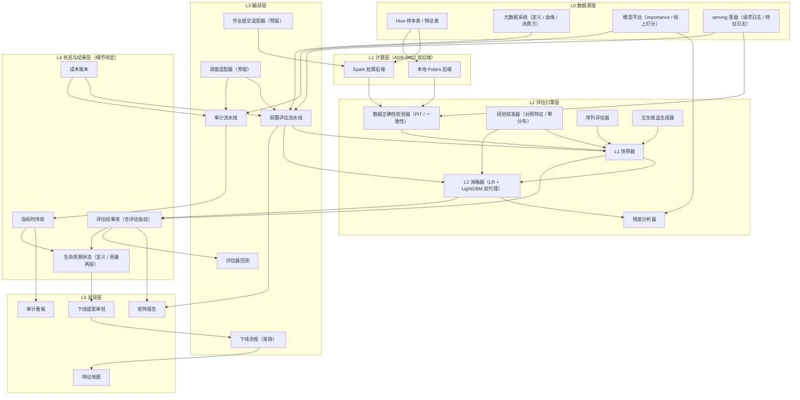
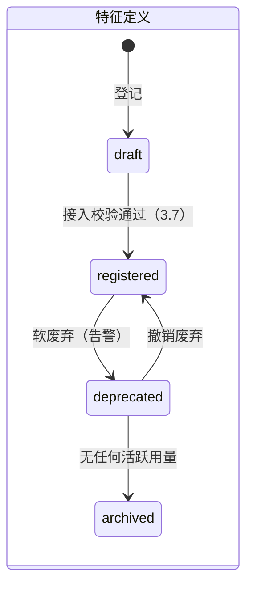
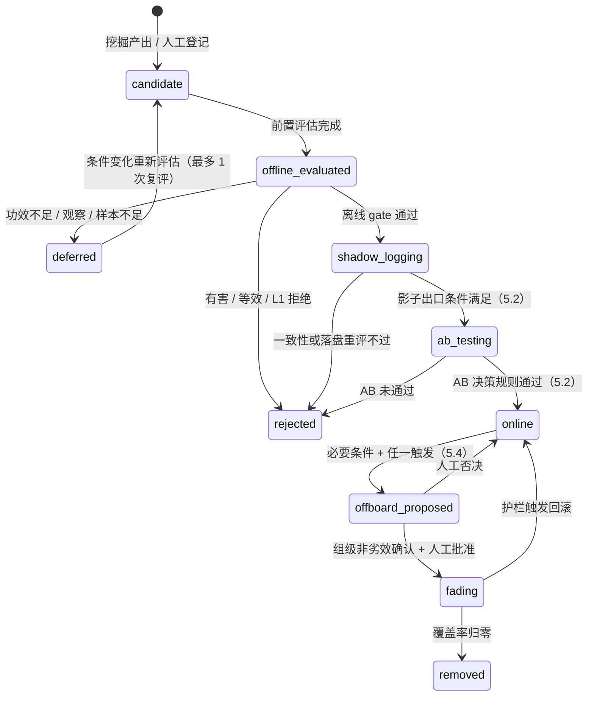

# 特征前置评估与生命周期管理 · 总体方案设计

- 状态：评审中（v0.3，2026-10-29；v0.2 原文存档于 `archive/总体方案设计-v0.2.md`，v0.1 存档于 `archive/总体方案设计-v0.1.md`；改动见第 9 章）
- 关联：`CONTEXT.md`（术语表）· ADR-0001（双层评估）· ADR-0002（双后端引擎）· ADR-0003（适配器隔离）· ADR-0004（入模优效、下线非劣效）· ADR-0005（两层生命周期，提议）· ADR-0006（L2 统计协议，提议）· `业界调研附录.md` · `评审问题清单-v0.2.md` · 调研报告 `reports/特征前置评估业界调研.md`（第一轮）与 `reports/特征前置评估调研核验与深化.md`（第二轮，经原文核验）· 原型代码 `feval/`（仍为 v0.2 口径，见 7.4）
- 范围声明：本方案只定义**逻辑架构与过程详细设计**；物理运行架构、调度选型、元数据层细节为**明确推迟项**，集中登记于第 8 章。
- **数字的性质**：业界公开的是评估**协议**（冻结前向验证、经验零分布校准、IU/UI 多重检验校正、渐隐下线等），没有任何公司公开过特征级准入阈值或特征 gate 的 precision/recall（调研报告第二轮第一节）。本方案所有数值默认值都是**待内部标定的参数**，不是「对标业界的值」；带出处的数字只用来说明量级。

## 1. 背景与目标

### 1.1 问题

精排多目标模型群（CTR / CVR / 分行业残差模型 / PLTV / IAA / IAP）特征规模大，当前存在三个缺口：

1. 特征是否值得入模缺乏系统性前置判断，单看特征分布无法回答「加入后模型是否变好」；
2. 原始数据是否值得加工、加工成什么类型特征，缺乏方法化的判断依据；
3. 特征上线后缺乏有效性审计与下线机制，特征集只增不减。

### 1.2 目标：三大能力

| 能力 | 回答的问题 | 方案位置 |
|---|---|---|
| 前置评估 | 这个特征值得入模吗？ | 第 3 章（L1 快筛 + L2 增量，ADR-0001、ADR-0006） |
| 特征挖掘 | 这块数据值得加工成什么类型的特征？ | 第 4 章 |
| 生命周期管理 | 什么条件能上线？上线后有效吗？何时下线？ | 第 5 章（ADR-0004、ADR-0005） |

另有一项贯穿三者的支撑能力：**评估器可信度**——评估器自身要版本化、用对照特征校准、用冻结回测对线上真值验收（3.6、7.3）。离线评估在业界的角色是「淘汰」而非「裁决」，最终裁决是线上 AB；评估器的价值在于用更少的 AB 资源筛掉不值得做 AB 的候选，因此必须度量它漏掉了多少本会在线上胜出的特征。

### 1.3 定位

长期项目「广告特征工程能力与自我提升项目」的工程落地。终局为企业内部平台服务（调度 + 特征地图 + 团队自助使用），按第 7 章分期演进；本仓库与母项目的边界 V2 之后再定（第 8 章 #9）。v0.1 只产出方案；v0.2 起并行建设本地原型（V0，见 7.1），用带真值的 mock 数据验证判据；v0.3 依据两轮业界调研（第二轮逐条对原文核验）重写统计判据、负对照、数据正确性检验与生命周期模型。

## 2. 总体逻辑架构

### 2.1 分层图



### 2.2 模块职责

| 层 | 模块 | 职责 | 输入 | 输出 |
|---|---|---|---|---|
| L1 | Spark 批算后端 | 生产规模（100w/1000w 可配置）指标计算 | Hive 表 + 特征/标签声明 | 指标结果表 |
| L1 | 本地 Polars 后端 | 采样/调试/小样本分析，口径与 Spark 后端互校 | 本地样本文件 | 同上 |
| L2 | 数据正确性校验器 | 候选接入时的时点正确性测试 P1–P6、影子期一致性检查 S1–S5（3.7） | 候选提交表 + 请求日志 + 特征日志 | 违规清单、一致性指标 |
| L2 | L1 快筛器 | 全部纯统计指标（3.1） | 特征列 + label 列（只读训练日） | L1 指标与等级 |
| L2 | L2 消融器 | 双代理加/去特征对照实验、四分区判定、联合确认（3.2） | 样本 + 代理基线快照 + 候选 + 口径卡 | ΔLogLoss/ΔAUC/ΔGAUC + 总方差 CI + MDE |
| L2 | 残差分析器 | 候选对线上模型残差的解释力（3.2.4） | 线上 logit（带版本）+ label + 特征 | 残差指标 |
| L2 | 经验校准器 | 生成同构对照特征，按层拟合经验零分布，正对照检出率曲线（3.6） | 候选元数据（粒度/类型）+ 探针结果 | 各层阈值、(μ̂, σ̂)、MDE 曲线 |
| L2 | 序列评估器 | 序列特征三层拆解（3.3） | 序列列 + 候选侧信息 | 统计代理指标 / 探针指标 |
| L2 | 交叉候选生成器 | 受控生成交叉候选（3.4） | importance + 特征元数据 | 交叉候选清单（≤500/轮） |
| L3 | 前置评估流水线 | 编排 挖掘/人工候选 → 接入校验 → L1 → L2 → 报告 → gate | 候选清单 | 矩阵报告 + gate 结论 |
| L3 | 审计流水线 | 编排 日效果与校准 / 周 importance / 月全量审计 | 在线特征用量 | 指标时序 + 审计报告 |
| L3 | 下线流程 | 编排 提案 → 组级非劣效确认 → 渐隐 → 移除 → 归档（5.4） | 下线提案 | 状态流转 + 归档记录 |
| L3 | 评估器回测 | 冻结评估器版本对线上 AB 结论做前向验证（7.3） | 评估结果 + AB 结论 | 回测报告 |
| L4 | 指标时序库 | 在线特征监控指标时序 | 审计流水线产物 | 时序查询 |
| L4 | 生命周期状态 | 特征定义与特征用量两层状态的权威记录（5.1） | 状态迁移事件 | 当前状态 + 历史 |
| L4 | 评估结果库 | 每次前置评估的 L1/L2 结果与评估指纹（3.5） | 评估流水线产物 | 矩阵报告数据源 |
| L4 | 成本账本 | 特征的存储、计算、在线、模型侧与维护成本，折算为元/天（5.5） | 资源计量 + 告警记录 | 单特征成本 |
| L5 | 矩阵报告 / 审计看板 / 特征地图 / 提案审批 | 呈现与人工决策入口 | L4 数据 | 报告页面 |

### 2.3 核心数据流

1. **前置评估流**：候选（挖掘产出或人工登记）→ 接入校验（提交规范 + P1/P2，3.7）→ L1 快筛 → L2 消融 + 残差分析 → 确认日上的联合确认 → 矩阵报告 → 离线 gate → 影子落盘 → AB → 入模。L1 的过滤率以 V1 实测为准（v0.2 写的「约 80%」没有依据，已删除）。无法离线回填的实时特征先进影子落盘，用落盘数据跑 L1/L2（log-and-wait）。
2. **审计流**：在线特征用量 + 样本表 → 日 效果/分切片校准/数据质量 → 周 importance 回传（生产模型内打分 + 代理侧 LOFO）→ 月度审计 → 指标时序库 → 审计看板 → 下线提案（必要条件 + 任一触发，自动生成）。
3. **下线闭环**：下线提案 → 组级非劣效确认（5.4）→ 人工审批 → serving 层渐隐 → 覆盖率归零后移除 → 定义层无活跃用量时归档 + 特征地图更新。
4. **评估器回测流**：评估器版本冻结 → 冻结后启动的 AB 结论回填评估结果库 → 前向回测报告（7.3）→ 下一版本评估器的参数调整（只能在新版本中生效）。

触发模式：审计类 = 定时；评估类 = 事件（候选提交）；下线与回测 = 步骤依赖驱动。调度适配器统一承接三类触发（选型待定，见第 8 章）。

## 3. 前置评估详细设计

### 3.0 目标口径卡与预注册参数

矩阵报告的每一列（一个目标模型）先有一张口径卡，评估引擎只按口径卡取数、切分和选指标；口径卡没填完的列不进入评估。

| 字段 | 含义 | 用在哪里 |
|---|---|---|
| label 与 label 类型 | 二分类 / 连续 / 零膨胀连续 | 指标族（3.1.1 / 3.1.4） |
| 样本空间 | 曝光 / 点击 / 激活 / 付费 | 样本表口径，CVR 类必须写明 |
| 成熟期 | label 从事件发生到稳定所需天数（归因窗口、LTV 窗口） | 时间切分（3.2.2） |
| 负采样率 | 负样本保留比例 | LogLoss 与校准类指标需按采样率还原 |
| 分组键 | user 或 request | Poisson 权重播种、GAUC（3.2.2） |
| 适用人群 | 该模型服务的样本子集（如某行业的广告） | 评估前先按它过滤样本 |
| 主指标 | 检验量固定为 ΔLogLoss；效应量报告 AUC / GAUC / 归一化 Gini 等 | L2 判定与报告（3.2.2） |
| 护栏指标 | 离线护栏：ΔLogLoss 非劣；用于出价的目标追加分桶校准偏差非劣 | 3.2.3、5.2 |

**预注册参数**（v0.3 新增，写入评估器版本，批次开始后不得修改；默认值均待校准，见第 8 章 #8）：

| 参数 | 含义 | 默认值 |
|---|---|---|
| α₁ | 每个代理的单侧检验水平 | 0.025 |
| q | 批内 FDR 水平（BH） | 0.10 |
| β | 第二类错误 | 0.20 |
| B | bootstrap 复本数 | 2000（BH 需要 p 值分辨率，m=100 时 B=1000 不够） |
| K | 滚动验证窗口数，相邻 valid 日间隔 ≥ 成熟期 | 4 |
| R | 训练端重加权重训次数，由 κ 校准（3.2.2） | 校准后定，1 或 3–5 |
| δ_min | 入模优效边界，= max(δ_stat, δ_biz)（3.2.2、5.5） | δ_stat = 0 |
| Δ_eq | 等效边界（「确认没有值得要的增益」） | ≥ 3.24·SE_budget |
| Δ_NI | 非劣效边界（下线、护栏、次目标） | ≤ δ_min；δ_min = 0 时取 0.5·Δ_eq |
| 确认日 | 联合确认用的独立数据（3.2.5） | 比最后一个 valid 日更晚的一个成熟日；不可得时用 L2 用户哈希拆出 30% |

当前已知情况（未确认项统一登记在第 8 章）：

| 目标 | label 类型 | 样本空间 | 成熟期 | 其余字段 |
|---|---|---|---|---|
| CTR | 二分类 | 曝光 | ≈ 0 天 | 待确认 |
| CVR | 二分类 | 点击（待确认） | 归因窗口（#4） | 待确认 |
| 分行业残差 ×N | 待确认（#6） | 待确认 | 待确认 | 适用人群 = 各行业 |
| PLTV | 待确认（通常为连续值，#10） | 待确认 | LTV 窗口 | 待确认 |
| IAA / IAP | 待确认（#10） | 待确认 | 待确认 | 待确认 |

### 3.1 L1 快筛（纯统计，不训练任何模型）

#### 3.1.1 指标族

| 组 | 指标 | 定义 | 离散特征 | 连续特征 |
|---|---|---|---|---|
| 区分度 | IV | 分桶后 Σ(pos%−neg%)·ln(pos%/neg%) | 直接按类别分桶 | 等频分桶 |
| 区分度 | KS | 累积正负样本分布最大差 | 按桶累积 | 等频分桶 |
| 区分度 | 单特征 AUC | 两折 OOF：一折的桶转化率定桶序，另一折算 AUC（按分组键分折） | 同左 | 同左，先分桶 |
| 区分度 | 互信息 | I(feature; label) | 离散直接 / 连续分桶后 | 同左 |
| 稳定性 | PSI | 按天分片 vs 基期的分布漂移；**只打稳定性标签，不作拒绝条件**（3.1.3） | 同上 | 同上 |
| 稳定性 | 时间分片 AUC 衰减 | 训练日首日 vs 末日单特征 AUC 差 | 同上 | 同上 |
| 质量 | 缺失率 / 覆盖率 / 单值占比 | 分布健康度 | — | — |
| 质量 | 时点正确性 | P1/P2 测试（3.7） | 硬 gate | 硬 gate |
| Lift | 分桶 label rate lift | 各桶转化率 / 全局转化率 | 同上 | 同上 |
| Lift | 趋势单调性 | 桶序 vs 桶转化率的 Spearman 相关（只做描述） | 同上 | 同上 |

- **数据范围（v0.3，R3）**：用到 label 的指标（IV、KS、单特征 AUC、互信息、缺失箱 IV、Lift）**只读 L2 第一个 valid 日之前的训练日**；PSI 不用 label，继续用全部天数。v0.2 让 L1 与 L2 共用验证日，等于先在验证日上挑特征、再在验证日上评估，候选越多偏差越大。若某场景 L1 必须用最新数据，改为按 user 哈希拆出 20–30% 用户专供 L1，代价是 L2 的 SE 膨胀 1.12–1.20 倍。
- 以上是二分类 label 的口径，连续型 label 见 3.1.4。缺失率只在**特征定义域**内计算（见 CONTEXT.md）：定义域外是结构性缺失，不计入缺失率，但缺失箱照常参与 IV 与 Lift。
- 训练/推理 skew 从 L1 移到影子期（3.7 S1–S5）：L1 阶段通常还没有线上落盘值。

#### 3.1.2 分桶自适应规则

核心约束：**每桶正样本 ≥ 50（硬下限）/ 100（理想）**，否则桶级转化率置信区间过宽，Lift 全是噪声。

- 桶数 `k = clamp(floor(正样本总数 / 100), 3, 10)`；桶内正样本 < 50 时自动合并相邻桶。
- 正样本总数 < 300：标记「样本不足，建议累积更长窗口」，不硬拒。
- 连续特征等频分桶；离散高基数先按频次聚 top-N + other（N 使累计覆盖 ≥ 95% 或 N ≤ 100）。
- 缺失作为独立箱参与 IV/Lift 计算（缺失本身可能是信号）。

经验参照表（默认配置，按 label 覆写）：

| 场景 | 正样本率 | 样本量 | 正样本 | k |
|---|---|---|---|---|
| CTR | ~5% | 100w | 5w | 10 |
| CVR | ~1% | 1000w | 10w | 10 |
| 低频 CVR | 0.1% | 1000w | 1w | 10（边界） |
| 深度转化（IAP/PLTV） | 0.01% | 1000w | 1000 | 10，需合并小桶 |
| 同上 | 0.01% | 100w | 100 | 3 桶起 + 「样本不足」标注 |

#### 3.1.3 gate 阈值：同层探针分位数 + 固定下限

v0.2 用固定阈值（AUC 偏移 0.005 / 0.02 等）。mock 校准显示，固定阈值 0.005 在 mock 的样本量下约为一个噪声标准差，且每层每批只有 3 个探针，等价于名义误放率 25% 的 max 规则（7.1 #9）。v0.3 改为**按粒度分层的同构探针分位数，固定值只作下限**（第 8 章 #14）：

- 每层（行 / 用户×天 / 用户 / 交叉 / 序列，构造见 3.6.1）放 **N_L1 = 199** 个同构探针；L1 不训练模型，成本可忽略。
- 依据（次序统计量）：零候选与 N 个探针可交换时，「超过第 k 大探针」的误放率恰为 k/(N+1)，单批实际误放率服从 Beta(k, N+1−k)。N=199、k=10 时名义 5%，单批 90% 区间 2.8%–7.8%；N=3 时名义 25%，区间 1.7%–63%。

| 指标 | 通过 | 观察 | 拒绝 |
|---|---|---|---|
| 单特征 AUC 偏移 | ≥ max(0.02, 该层探针 99.5% 分位) | [max(0.005, 探针 95% 分位), 通过线) | < 拒绝线 |
| IV | ≥ max(0.02, 该层探针 99.5% 分位) | 同理 | 同理 |
| 缺失率（定义域内） | < 5%，或缺失箱 IV 达到通过线 | [5%, 20%) 且缺失箱无区分度 | ≥ 20% 且缺失箱无区分度 |
| PSI | 不参与判定；打 `stability_tag`：< 0.1 stable / [0.1, 0.25) watch / ≥ 0.25 drifting（信用评分惯例，未校准） | — | — |

- 每轮多达 500 个交叉候选时，「通过」改用经验 p 值 (1+#{探针 ≥ 候选})/(N+1) 再做 BH(q=0.1)，此时每层 N 取数千。
- **漂移不再拒绝（R8）**：VLDB 2024、NannyML 的 580 组实验、Vertex AI 的监控设计都表明漂移不是效果下降的可靠代理（第二轮报告第五节）。drifting 特征进入 L2 后加做时间外推稳定性检验（3.2.2）。只有两类「伪漂移」直接阻断：数据质量问题（缺失率或默认值占比突变、常量化）与时点泄漏（3.7）。
- **疑似泄漏改为多信号（v0.2 的「IV > 0.5」没有一手出处，降为经验值）**，任一信号触发即转人工，并强制跑 P1/P2：

| 信号 | 定义 | 起始阈值 |
|---|---|---|
| L-a 绝对强度 | 单特征 AUC 或 IV 超过本场景已知干净特征的 P99；或 PPS ≥ 0.7（deepchecks 默认值） | 校准 |
| L-b 时间回落 | 随机切分与时间切分的 ΔPPS（或 ΔAUC）过大 | ΔPPS ≥ 0.2（deepchecks 默认值） |
| L-c 可得性 | P1 或 P2 有违规 | 0 容忍 |
| L-d 延迟敏感 | P4 不通过 | 3.7 |
| L-e 线上回落 | 影子期落盘值的单特征 AUC 显著低于离线回填值 | 3.7 |

  阈值校准：以合成泄漏（label 加噪混入、窗口越过 sample_ts、用回填修正值替代原值）为已知阳性、已上线干净特征为已知阴性，按 ROC 选阈值，目标泄漏召回 ≥ 95%、干净特征误报 ≤ 5%；每季度用新确认的真假阳性更新。

L1 结论等级：`通过 / 观察 / 拒绝 / 疑似泄漏（转人工）/ 样本不足`，另附 `stability_tag`。只有「通过」进入 L2。

**合成规则**（按顺序取第一个命中的等级）：

1. 正样本 < 300 → 样本不足；
2. L-a 至 L-e 任一触发 → 疑似泄漏（转人工）；
3. 时点或数据质量阻断项命中，或区分度两项都低于拒绝线，或缺失率 ≥ 20% 且缺失箱无区分度 → 拒绝；
4. 区分度最高只到观察带，或缺失率 ∈ [5%, 20%) 且缺失箱无区分度 → 观察；
5. 其余 → 通过（IV 与 AUC 偏移任一达到通过线即可）。

#### 3.1.4 连续型 label 的指标族（V2 实现）

PLTV、IAA 收入等金额型 label 不能套用 IV/KS/AUC：

- L1：Spearman ρ、分桶均值 Lift（各桶均值 / 全局均值）、归一化 Gini；PSI 与缺失率规则不变。
- 零膨胀（大部分样本为 0）：拆成「是否发生」（二分类，走 3.1.1）与「发生后的金额」（连续，只在正样本上算）两段。
- L2：检验量改为对应损失（零膨胀用 ZILN 负对数似然，否则 log1p 尺度的平方误差）的逐样本配对差，效应量报告归一化 Gini；判定协议同 3.2.2。

### 3.2 L2 增量评估

#### 3.2.1 代理模型与代理基线快照

- **LR + LightGBM 双代理**：LR 对齐线性效应，LightGBM 捕非线性与交互；两个都跑、都报告。合并口径见 3.2.2（v0.3 起双代理的 α 在 p 值层面收回名义水平）。
- **代理基线快照**（v0.3，R2）：版本化的 `proxy_baseline@v`，内容包括：
  1. 特征清单；
  2. 代理无法使用的线上信息（序列、ID embedding、复杂交叉）的处理方式。默认用**用户历史目标统计**替代 ID 记忆（第 8 章 #13）：训练行用 5 折 OOF 或 ordered 方式计算，验证行用全部训练日，贝叶斯平滑先验强度 20 次曝光。这样剩下的增量是「超出用户固定效应」的部分，与线上带 ID embedding 的模型对齐；
  3. 代理超参与早停策略（R18），整体纳入评估器版本。
- 数据 ≤ 500w 采样后本地训练，采样**按分组键整组抽取**以保留聚类结构；更大规模走 Spark 路径（预留，对齐 ADR-0002）。
- **代理结论的定位**：代理特征价值向深度模型的迁移证据很弱。ERASE 基准中 GBDT、Lasso 等浅层方法为深度 CTR 模型选特征整体最差；跨模型族的重要性排序相关只有 0.18–0.36（人脸识别场景，外推需谨慎）。因此代理消融对「噪声与冗余」的判断相对可信（下线初筛），对新特征准入只是粗筛；只有深度模型能利用的增益（高基数 ID 交互等）要靠残差分析或 L3 热启动通道补证（3.2.4）。报告必须标注这一折扣。

#### 3.2.2 消融协议（ADR-0006）

**样本与切分**：

- 时间外推：K 个 valid 日，最后一个 valid 日 ≤ 数据末日 − 成熟期，相邻 valid 日间隔 ≥ 成熟期；每个 valid 日用它之前的天训练。label 未成熟的天不参与评估。
- 基线组（代理基线快照）vs 实验组（+候选），同配置训练。候选若本来就在基线里（正对照），先从基线移出。

**权重（同一套随机数服务所有候选、代理和窗口）**：

```
w_eval[u, b]  = Poisson(1)，种子 = hash(salt, user_id, b)          # 评估端，b = 1..B
w_train[u, r] = Poisson(1)，种子 = hash(salt, user_id, "train", r) # 训练端，r = 1..R；with/without 两侧共用
```

同一分组单元的全部样本在每个复本中同权（Chamandy 等：可交换单元是 user，用单元 ID 哈希播种，Spark 上可逐行生成）。v0.2 只覆盖评估端；原型 LightGBM 用 subsample=1、固定 random_state，LR 是凸优化，「换种子」几乎不产生方差，**真正漏掉的是训练样本的抽样方差**，所以训练端改为 Poisson 重加权后重训 R 次。

**检验量与方差**：

```
d_i      = logloss_base,i − logloss_exp,i                   # 逐样本配对增益，正为好；负采样按口径卡还原
Δ̄_jk     = Σ_w n_w · mean_r Δ_jkwr / Σ_w n_w                # 候选 j、代理 k，窗口按样本量合并（固定效应）
V_eval   = Var_b( 每个复本 b 内先对 r、w 求平均后的 Δ̄* )      # 跨窗口相关已包含在内
s²_train = mean_w Var_r( Δ_jkwr )
SE²_jk   = V_eval + s²_train / R
```

- **检验量用 ΔLogLoss，ΔAUC 只作效应量报告**：嵌套模型上基于 ΔAUC 的检验过于保守（Pepe 2013 模拟中检验水平 < 0.005；Demler 2012 的结论限定于同一数据建模并验证，时间外推下不完全适用），似然比类统计量渐近最有功效。ΔAUC、ΔGAUC 用同一套权重给 CI。
- **R 的校准**：用约 20 个候选（含正、负对照）跑 R=10，估计 κ = s²_train/V_eval。中位 κ < 0.1 时生产用 R=1，SE 乘以 √(1+κ̂₀.₉)；否则生产用 R=3–5。增加评估数据压不掉训练端方差。

**经验校准与多重比较**（3.6.3）：

```
Z_jk = (Δ̄_jk − μ̂_g − δ_min) / sqrt(σ̂_g² + SE²_jk)      # g = 候选所属粒度层；无探针时 μ̂ = σ̂ = 0
p_jk = 1 − Φ(Z_jk)
p_j  = min(1, 2 · min_k p_jk)                          # 双代理「任一」规则，Bonferroni 收回名义 α（也可用 Simes）
优效集合 = BH(p_j, q)                                    # 负对照显示 FDR 超标时改 BY 或 max-T 联合 bootstrap
MDE_jk = δ_min + μ̂_g + (z₁₋α₁ + z₁₋β) · sqrt(σ̂_g² + SE²_jk)   # 乘子 2.80；双代理 Bonferroni 口径为 3.08
```

v0.2 的判据正是 μ̂ = σ̂ = 0、R = 1、单窗口、不做 BH 时的特例，迁移不改变判定的方向，只补上训练端方差、对照校准和多重比较。v0.2 写的「两个单侧检验取并，误放率上界从 2.5% 升到 5%」由 p_j 的 Bonferroni 合并消除。

**四分区判定（R4）**。用 (1−2α₁) 的区间 [L, U] = Δ̄ − μ̂ ± 1.96·√(σ̂² + SE²)：

| 结论 | 条件 | 去向（5.1） |
|---|---|---|
| 优效 | j ∈ BH 集合；可选：ΔAUC 下界 > 业务门槛 | 进入离线护栏与联合确认 |
| 有害 | 两个代理的 U 都 < 0，且 ΔLogLoss 与 ΔAUC 方向一致 | 已拒绝 |
| 等效（无实质增量） | 两个代理的 U 都 < Δ_eq | 已拒绝（「确认没有值得要的增益」） |
| 功效不足 | 其余 | 暂缓：报告 MDE 与所需用户数 n_c = n_c0·(SE₀/SE_target)²；最多复评 1 次，两次各用 α/2 |

- Δ_eq 必须 ≥ 约 3.24·SE，否则真实为零的特征也大多落进「功效不足」。v0.2 把「无显著增量」直接映射到拒绝，真实新特征大多是弱增量，会被成批误杀；v0.3 只拒绝能确认「没有值得要的增益」的候选。
- 若 R ≥ 3，额外要求候选在 R 次重训中「优效」出现频率 ≥ 0.5（借用去随机化 knockoff 的稳定化思想，不继承其误差保证）。

**滚动多窗与稳定性（R9）**：

- 不采用「3 窗至少 2 窗通过」：逐窗显著的通过概率约为 power^K，「任一窗显著」则 α 约放大 K 倍。v0.3 只用合并检验做判定，另报告三项不消耗 α 的稳定性诊断：I²、正号窗口占比 k⁺/K、留一窗口的 Δ̄ 范围。I² > 50% 或 k⁺/K < 2/3 时结论标为「优效-不稳定」并转人工。
- `stability_tag = drifting` 的候选加严：合并优效之外，要求最差窗口点估计 ≥ −Δ_NI 且 k⁺/K ≥ 3/4（R8）。

**报告值**：入选者的 Δ 有选择偏差（赢家诅咒）。报告与排序用经验贝叶斯收缩 Δ^EB = μ̂ + τ̂²/(τ̂² + SE²)·(Δ̂ − μ̂)，τ̂² 用整批（含未入选）候选的矩估计；效应分布厚尾时改用「0 点质量 + Laplace」混合先验。收缩只用于报告和排序，不改变判定。

#### 3.2.3 多目标与门控顺序

主目标（特征声明主要服务的 1~2 个模型）必跑 L2；L1 矩阵中表现最好的其余 1~2 个目标加跑。残差模型与主模型同构处理：每模型一列，label 与样本口径从各自的口径卡读取（3.0）。

入模判定按预注册的固定顺序门控，前一步不通过即停止，总 FWER ≤ α：

1. 主目标在合并窗口上做 ΔLogLoss 优效检验（批内 BH）；声明 2 个主目标时，「任一优效」用 α/2。
2. （可选）主目标 ΔAUC 的业务门槛。
3. 离线护栏：主目标 ΔLogLoss 非劣（下界 > −Δ_NI，在优效已通过时通常自动满足，主要用于 GAUC 等效应量口径分歧时）；CVR、PLTV 等用于出价的目标追加分桶校准偏差非劣（R14）。
4. 共享底座（MMoE/PLE 类，特征进入共享 embedding）的次目标做非劣效检验，防止负迁移。这是交并（IU）结构：α 不校正，功效按 1−β/(G+1) 设计（Spotify 2024 Prop 3.1），G=2 时乘子为 1.96+1.50=3.46。模型结构待确认（第 8 章 #11）。
5. 稳定性诊断（3.2.2）。
6. 确认日上的联合确认（3.2.5）。

入模关系定在「特征 × 模型」一级（5.1），每个主目标模型各自判定，生成各自的用量记录。

#### 3.2.4 残差分析（依赖线上打分，与代理消融并列）

1. **线上分来源与版本（R2）**：优先使用 serving 时刻落盘的 logit；只能回放时，所用 checkpoint 的训练截止时间必须早于评估窗口起点，否则模型已见过验证日标签，残差增量会被系统性低估。版本字段见 6.5。
2. 线上分先在训练日上做 Platt 校准，校准后的 logit 作 init_score（LR 用 offset），只用候选特征在真实 label 上继续拟合；评估时同时传入 eval_init_score。LightGBM 传入 init_score 后不会再从标签均值起步（源码 `BoostFromAverage` 只在无 init_score 时执行），但预测值不含 init_score，要手动加回。
3. **同构对照**：比较「线上分 + 候选」与「线上分 + 候选的同构置换副本」（3.6.1），两者树数与正则相同，扣除 boosting 自由度带来的纠偏收益。v0.2 对照的是裸线上分，会把纠偏收益算成候选的增量。另跑一个「候选 + top-5 已有特征」版本捕捉交互。CI 与判定同 3.2.2。
4. 描述用：候选各桶的平均残差（即分桶校准偏差）。
5. **代理 × 残差合并矩阵**：

| 代理结论 | 残差结论 | 合并结论 |
|---|---|---|
| 优效 | 优效 | 强建议入模 |
| 优效 | 等效或功效不足 | 降为暂缓，标「疑似已被线上模型覆盖」 |
| 非优效 | 优效 | 建议入模（代理看不到的信息）；进入 L3 热启动通道或直接进 AB |
| 有害或等效 | 有害或等效 | 拒绝 |

6. **L3 热启动通道**（只处理两者冲突的候选）：在生产 checkpoint 上加一个初值保证输出不变的 embedding 或 gate（LPFS 的「gate 除以初值」做法），用评估窗口之前的数据短训后比较。没有公开论文报告过这一做法与 AB 结果的相关性，作为补证手段，不单独构成准入依据。

#### 3.2.5 通过者联合确认

同批优效的候选集合 S，在确认日（3.0）上**只做一次**：

1. 「F + S 对 F」的整体优效检验；不通过则全批降为暂缓并转人工。
2. 对 S 中每个成员做「从 F + S 中去掉后非劣」的检验（下界 > −Δ_NI）；非劣者视为被同批其他候选覆盖，剔除。按收缩后的 Δ^EB 从小到大依次尝试剔除，每剔除一个在剩余集合上重判。

v0.2 在同一份验证数据上先排序再逐个检验，存在选择偏差；原型 `confirm_jointly` 同样如此（7.4）。

### 3.3 序列特征评估（三层拆解）

输入形态声明：ID 序列 / 类目序列 / 定长 embedding 三种均支持（登记于特征元数据）。

| 层 | 手段 | 归属 |
|---|---|---|
| ① 统计代理 | 序列长度分布、空序列占比、top-K 元素覆盖率、元素新近度；**target-aware 统计**：用户序列与当前候选的类目/行业命中次数、最近命中位置倒数、时间加权命中 | L1，按 3.1 走 |
| ② 压缩探针 | 元素编码（target encoding 或复用现有 item embedding）→ mean/sum/max pooling 成定长向量 | L2 入口，走 3.2.2 |
| ③ 信息增量 | 在「已有统计特征集」之上评估序列特征的剩余增量：代理消融，或线上分可得时按 3.2.4 的 init_score 口径做残差增量 | L2 |

v0.2 第 ③ 层写的「残差 AUC」不成立（残差 r 是连续值），已改为 3.2.4 口径（R12）。同构负对照见 3.6.1：用户间整段置换（检验内容）、换用该用户更早日期的快照（检验时点）、序列内打乱顺序（检验顺序）。判定要点：若统计代理已解释殆尽而探针无增量，说明不需要序列建模，统计特征即可入模。时点正确性对所有特征生效（3.7）。

### 3.4 交叉特征评估（三段式，控制组合爆炸）

1. **候选生成**（每轮上限 500）：① 已入模特征 importance top-K（K≈20）× 候选特征；② 同域交叉（user×item、行业×创意）；③ 业务规则指定。
2. **L1 条件快筛**（v0.3，R11）：两个强父特征的交叉 IV 天然就高，按新离散特征算 IV 起不到过滤作用。改为检验「交叉相对两个父特征的加性模型有没有额外交互信息」：用同一张二维计数表 (a, b, pos, neg) 计算条件互信息 I(a×b; y) − I(a; y) − I(b; y) 的估计或加性 logit 模型的偏差下降，仍是计数表的纯函数，不破坏双后端共用的接口。负对照为 **f(a′, b)**，a′ 是 a 在 b 的各层内置换（离散条件变量下的条件置换检验，是合法的增量零假设）；b 连续时按 10 分位分箱，此时只是近似。阈值按 3.1.3 的经验 p 值 + BH。
3. **L2 增量**：基线包含两个父特征，交叉特征按 3.2.2 做优效判定；若「加交叉同时去父特征」非劣（两个代理都满足），标记「交叉可替代父特征」。
4. Friedman H-statistic 作为交互解释备选工具；AutoCross 式 beam search 全自动搜索列入二期调研（见附录 §3、§5）。

### 3.5 矩阵报告与主目标

- 行 = 候选特征，列 = 目标模型（CTR / CVR / 残差×N / PLTV / IAA / IAP，同构处理）。
- 每格：L1 等级 + stability_tag + L2 四分区结论 + 主检验量 ΔLogLoss 与效应量 ΔAUC（含 CI）+ MDE + 收缩后的 Δ^EB。图标：✅ 优效 / ⏸ 功效不足（暂缓）/ ⚪ 等效 / ❌ 有害或 L1 拒绝 / ⊘ 样本不足 / 🔍 疑似泄漏 / ⚠️ 优效-不稳定。
- 每批报告附**对照检查段**（3.6）：各层负对照误放数与校准后 p<0.05 比例、(μ̂, σ̂) 及其近 10 批走势、正对照分级检出率曲线与 MDE。
- **gate 按主目标列判定，其余列仅参考**——避免「所有列都必须好」误杀只服务特定目标的特征。
- **评估指纹**（R16）：数据分区、口径卡版本、代理基线快照版本、评估器版本（预注册参数 + 零分布参数 + 斜率 b̂）、代码版本、哈希 salt、R/K/B。报告可据此复跑。
- 下钻页：分桶表 / Lift 图 / PSI 时序 / 分窗口 Δ 森林图 / 残差分桶 / 正对照检出率曲线。

### 3.6 对照特征与评估器校准（v0.3 新增）

术语见 CONTEXT.md「对照特征」「评估器校准」「经验零分布」。

#### 3.6.1 同构负对照

**负对照必须与候选同构**：负对照用来估计「零增量候选」的统计量分布，只有与候选可交换时，这个分布才适用于候选（OHDSI 经验校准的前提；Boruta、null importance、置换检验同理）。mock 中用户级常量随机数在 LightGBM 上误放 17%，而行级探针基本不误放，就是粒度不同构的后果。

| 候选类型 | 同构负对照 |
|---|---|
| 行级 | 候选值全局置换 |
| 用户级（用户内常量） | 用户间整块置换 |
| 用户×天 | 默认同一天内跨用户置换；检验时间维增量时，改为同一用户内跨天置换 |
| 交叉 f(a, b) | f(a′, b)，a′ 为 a 在 b 层内置换（3.4）；廉价版 f(perm(a), b) 只保证基数和稀疏度同构 |
| 序列 | 用户间整段置换 / 更早日期快照 / 序列内打乱 |
| 冗余型 | 每层 ≥ 5 个「基线特征 + 噪声」（落实 7.1 #6） |

置换副本保留了候选自身的取值分布，比通用随机数更好；完整 Model-X knockoff 需要对全部特征联合分布建模，knockoff+ 还至少要选出 ⌈1/q⌉ 个特征才能报告发现，不适合本场景。

#### 3.6.2 正对照与检出率曲线

- 每层注入 3 档分级正对照：同构探针 + λ·z(已知有效特征)，λ 使 ΔAUC 约为该层 SE 中位数的 1×、2×、4×。
- 报告检出率曲线并标出 MDE（R4）；最弱一档检出率 < 50% 时，报告提示「本层功效不足」。
- 另从基线中挑 1–2 个已知强特征移出作为完整正对照（沿用 v0.2）。

#### 3.6.3 L2 经验零分布

借用 OHDSI 的经验校准：每个负对照的估计 y_i ~ N(θ_i, τ_i²)，θ_i ~ N(μ, σ²)，用极大似然估计 (μ̂, σ̂)；新候选按 N(μ̂, σ̂² + SE²) 计算 p 值（3.2.2 的 Z_jk）。μ̂ 吸收系统性偏差（如残余的 ID 记忆奖励），σ̂ 吸收 bootstrap 没覆盖的额外波动。

1. 每层、每代理、每批新增 **20 个**探针做消融，与同一管线配置下的近期批次合并，累计 **≥ 50** 个后才启用该层校准；不足时该层 μ̂ = σ̂ = 0 并在报告中标注。
2. **留一法自检**：该层探针的校准后 p<0.05 比例应落在 [2%, 9%]，超出则该层标「校准不可信」，回退到人工加残差分析。
3. μ̂、σ̂ 超出近 10 批的 3σ 时，触发管线审查（等价于 A/A 检查）。
4. 管线配置（代理基线快照、超参、采样）一变，累计探针清空重来。
5. 代价：经验校准会提高第二类错误（Gruber & Tchetgen Tchetgen 2016）。检出率曲线（3.6.2）用来监控这一代价。OHDSI 方法用于 ΔAUC/ΔLogLoss 在机器学习领域没有找到先例，属本方案的迁移设计。

#### 3.6.4 用户粒度候选（第 8 章 #13）

- **主口径**：代理基线加入用户历史目标统计（3.2.1），从根上吸收用户固定效应。树模型会把用户级常量当用户 ID 记住每个用户的平均 label（CatBoost 的目标统计泄漏分析、GPBoost 的组效应结果支持这一机制；本项目 mock 的 17% 误放是同一现象）。
- **兜底**：用户层同构探针的经验校准，σ̂_user 与 μ̂_user 自动吸收残余的记忆奖励。
- **最终裁决**：残差分析可得时以它为准（mock 中残差判据下用户级探针误放 7%）。
- **诊断**：每季度或管线变更时跑一次新用户 holdout（训练用户与验证用户不相交），确认加入目标统计后 μ̂_user ≈ 0。
- **不采用**「只与同批用户级随机探针比较」作主判据：记忆奖励的大小随组数和树参数变化，阈值会随批次漂移，还会把真实但弱的用户级特征一起压掉。

### 3.7 候选接入与数据正确性（v0.3 新增）

#### 3.7.1 候选提交规范（R5）

提交方提供产出以下列的 SQL 或表：`(entity_key, value, event_ts, created_ts, avail_ts)`。

```
avail_ts = max(event_ts, created_ts, 批物化完成时刻 + data_delay)
join 条件：avail_ts ≤ sample_ts 且 sample_ts − avail_ts ≤ TTL；join 不到为 null，单独统计覆盖率
spine   = 线上请求日志（request_id, entity, sample_ts）
```

依据：各特征平台的时点 join 都取「特征时间 ≤ 样本时间」的最新值并受 TTL 限制，分歧在「特征时间」取哪个时间。Feast 默认只约束 event_timestamp，created_timestamp 只用于去重，回填或修正值会穿越（新版加了 `filter_by_created_timestamp=True`）；Tecton 用「最早可在线读到的时间」；Azure ML 扣除 source_delay。本方案统一取三者中最晚的 avail_ts。

#### 3.7.2 时点正确性测试套件（3.1.1 与 5.2 硬门槛的实现，R7）

| 编号 | 测试 | 判定 | 阶段 |
|---|---|---|---|
| P1 | 逐行断言 avail_ts ≤ sample_ts；窗口聚合右端点 < sample_ts 且不含样本自身事件 | 违规行数 = 0 | 接入 |
| P2 | 未来注入：向源表注入哨兵记录（event_ts > sample_ts；created_ts > sample_ts 模拟回填；恰在边界上的事件） | 哨兵命中 = 0 | 接入（管线变更时重跑） |
| P3 | 影子期落盘值 vs 离线回填值，按 key 哈希抽样逐值比较 | 见 S3 | 影子 |
| P4 | 延迟平移：sample_ts 整体前移 Δ ∈ {声明的 data_delay, 1h, 1d}（即 R7 的「错一天」测试），重算单特征 AUC | 降幅超过同类健康特征的 P99 → 可得时间被低估 | L1 |
| P5 | 日快照 vs 精确时点值 | 差异大的特征线上必须按快照语义服务 | 接入 |
| P6 | null 率随「样本时间 − 特征时间」的分布 | 纳入 S3 的 missing 指标 | 影子 |

#### 3.7.3 训推一致性分层检查（替换 v0.2 5.2 #6 的「≥ 99.9%」）

v0.2 的「训练/推理一致率 ≥ 99.9%」在一手来源中**找不到任何出处**（第二轮报告第四节）。Google 的口径是「完全一致」（ML Test Score Monitor 3：同一样本的特征值 "should be perfectly identical"；Rules of ML #37：有差异 "probably indicates an engineering error"）；Chronon 明言 100% 不总是做得到但不给阈值；唯一找到的数值容差是 PAI-Rec 的打分级 |Δscore| < 1e-4。

| 层 | 指标 | 起始阈值 |
|---|---|---|
| S1 schema | 名称、类型、取值域 | 0 容忍 |
| S2 分布 | 类别特征 L∞；数值特征 JSD（分位直方图）或归一化 Wasserstein | L∞ 0.01–0.05；JSD 或 Wasserstein 0.1；0.3 只作宽松上限（Vertex/BQML 默认值） |
| S3 样本级 | exact_match_rate = match/(match + mismatch + base_only + test_only)（TFDV DetectFeatureSkew 口径）、missing/extra rate、数值 SMAPE、序列编辑距离、join 失败率 | 确定性批特征 exact_match = 100%，任何 mismatch 逐条解释；实时、流式、日更特征按 lag 对齐后，以同类在线健康特征 mismatch_rate 的 P99 为线 |
| S4 打分级 | 同一请求离线分与在线分之差 | \|Δscore\| < 1e-4 的请求占比（PAI-Rec 口径） |
| S5 效果级 | Rules of ML #37 的三段差距（训练集、next-day、线上） | next-day 与线上显著有差即判工程错误 |

- S3 样本量：每个特征至少 1 万个两侧都有 ID 的样本（Rules of ML #34），覆盖一个完整日周期（含午夜：日更特征的不一致集中在午夜附近）。
- **数据通路差距诊断**：影子期在同一时段分别用落盘值和回填值评估同一模型，差值即数据通路差距（DoorDash 用这一做法把 4.3% 的线上线下 AUC 差距定位到特征陈旧，修复后降到 0.76%）。
- **用落盘值重跑 L2**：影子期结束时用落盘值重跑一次 L2，结论不变才可进 AB；落盘值天然不穿越，同时检验了训推一致性。

## 4. 特征挖掘详细设计

### 4.1 输入与画像

输入：Hive 表 + 字段级抽样画像（抽样 10w 行或全量小表）。画像维度：字段类型、基数、缺失率、时间属性（事件流 vs 快照）、实体键（user / item / industry / creative）、变化频率、与已有特征实体的关联关系。

### 4.2 画像 → 特征类型建议规则表

| 数据画像 | 建议特征类型 | 说明 |
|---|---|---|
| 主键 + 时间戳的事件表 | 窗口聚合 | 1/7/30d 计数、比率、去重数 |
| 快照表 | 当前值 + 变化率 | 相邻快照差分 |
| 高基数 ID（>1000） | target encoding / 计数统计 / 嵌入引用 | TE 必须 OOF 或 ordered 防泄漏 |
| 低基枚举（≤50） | 直接入模 + 交叉候选 | 交叉走 3.4 |
| 行为流（时序事件） | 序列特征 | 走 3.3 |
| 连续数值 | 分箱 / 统计变换 / 比率组合 | 分箱走 3.1 自适应 |
| 多实体关联表 | 关联侧聚合 | 按实体键 join 后统计 |

### 4.3 产出、优先级与衔接

产出候选清单：`{字段/表, 建议特征类型, 预估加工成本（点查 / 窗口聚合 / 序列回溯，按 5.5 成本账本口径）, 优先级}`，直接推入前置评估流水线（2.3 数据流①）。

**优先级规则**（v0.3，R17）：原始字段先直接跑一遍 L1（成本很低，且对同层探针分位数可比），按「L1 信号强度 ÷ 预估加工成本」排序决定加工顺序。

范围分期：V1 做存量特征表画像（找二次加工机会）；V2 扩展新原始表。AutoFE（OpenFE / Featuretools 等）与 LLM 建议并行调研、后置接入（遵循长期项目「先建模后 Agent」原则）。

### 4.4 误差驱动挖掘（V1 之后建设）

4.1–4.3 看的是「数据长什么样」（供给侧）；误差驱动挖掘从「模型缺什么」出发（需求侧）：

1. 用线上打分（6.5）算残差，按人群、广告主、行业、创意类型、时段等切片，找出排序能力最差或校准偏差最大的切片；
2. 把切片结论转成「缺什么信息」的假设，再按 4.2 规则表定向找数据源和特征类型；
3. 产出的候选照常走前置评估，并用残差分析（3.2.4）复核该切片是否被补上。

自动切片方法参照 Slice Finder（附录 §5）。

## 5. 特征生命周期设计

### 5.1 两层状态机（ADR-0005，R6）

v0.2 用一张状态机管「特征」，但多目标场景下一个特征可以在 CTR 模型里在用、同时在 CVR 模型里被提议移出：「从某个模型移出」便宜、可逆，「停掉特征管道」才真正省成本，两件事混在一起。v0.3 拆成两层：

- **特征定义（FeatureDefinition）**：特征实体本身（管道、存储），按 `feature_id@version` 区分；上游信号的任何变更（包括「修复」）都视为新版本，重新走评估（Sculley 2015：上游修复同样可能伤害下游模型）。
- **特征用量（FeatureUsage）**：`feature@version × 模型 × 场景` 的入模关系，是前置评估、AB、下线的对象。

已核的特征平台（Feast、Tecton、Hopsworks、Databricks、Vertex）都只有轻量的定义级状态（owner、废弃标记、删除保护）和「定义 → 模型」的反向索引，**没有平台把用量做成带状态的一等实体**，这一层是本方案的扩展。





- 无法离线回填的实时特征：`candidate → shadow_logging` 先行，用落盘数据跑前置评估后回到 `offline_evaluated`，再按上图继续（log-and-wait）。
- 定义进入 `archived` 的前置条件：反向索引中没有任何非 `removed`/`rejected` 的用量（对齐 Tecton `prevent_destroy` 的保护语义）。
- 用量记录字段：`eval_report_id, evaluator_version, experiment_id, flag_key, stage_entered_at, exit_criteria_snapshot, cost_ledger_ref, importance_series_ref, fade_rate, fade_progress`。

### 5.2 各阶段 gate

**离线 gate（offline_evaluated → shadow_logging）**，全部满足：

1. 接入校验：P1、P2 违规 = 0（3.7.2）；
2. L1 通过（3.1.3），非疑似泄漏；
3. L2 主目标优效（3.2.2，ADR-0004、ADR-0006）并通过门控顺序 1–6（3.2.3），含离线护栏与确认日联合确认；
4. 缺失率在特征定义域内按 3.1.3 判定；
5. 业务门槛：δ_min = max(δ_stat, δ_biz)（5.5）；增益显著但小于 MDE、且成本高于该场景成本分布 P25 的「ε-特征」默认不进 AB。

v0.2 的「连续 7 天 PSI < 0.1」已删除（R8）：漂移改由 3.2.2 的时间外推稳定性检验与影子期一致性检查覆盖。

**影子出口（shadow_logging → ab_testing）**，全部满足：

1. S1–S3 达标（3.7.3），P3、P6 无异常；
2. 取数 P99 延迟增量与超时率在预算内；
3. 线上覆盖率与离线评估口径一致；
4. 用落盘值重跑 L2，结论不变；
5. 时长 ≥ 7 天且覆盖一个完整周（经验值，无一手出处）。

**AB 决策规则（ab_testing → online，R14）**，采用 Spotify 2024 的决策规则：

1. 至少一个 success 指标（RPM、收入或 CTR/CVR）显著优效；多个 success 指标各用 α/S；
2. 所有 guardrail 显著非劣，非劣边界（NIM）预先登记；guardrail 的 α 不校正，功效按 1−β/(G+1) 设计；
3. 任何指标都没有显著劣化（劣化检验覆盖全部指标）；
4. 质量检验（样本比例失衡 SRM 等）全部通过。

广告场景的 guardrail 默认集：分切片校准（PCOC 或 ECE；扣费价格与 CTR 预估直接挂钩，校准必须是护栏）、P99 端到端延迟、超时率、广告主 ROI、负反馈率。AB 时长由护栏的功效反推，不固定天数。

### 5.3 监控与审计节奏

| 频率 | 内容 | 数据来源 |
|---|---|---|
| 日 | 带标签的效果与分切片校准；覆盖率、缺失率、默认值占比；S3 一致性抽检；PSI（只用于定位原因） | 样本表 + 特征日志 |
| 周 | importance 回传：生产模型内 Taylor 分数或遮蔽 ΔAUC（6.4）+ 代理侧 LOFO | 模型平台（适配器）+ 审计流水线 |
| 月 | 审计报告：importance 分位及趋势 / 与保留特征冗余度（相关 + 互信息）/ L1 指标重算对比基线 / 漂移标签 / 成本账本（5.5） | 审计流水线 |

监控优先级（R8）：带标签的效果与分切片校准 > 重要性加权或归因漂移 > 原始 PSI。NannyML 的 580 组实验中，用漂移信号估计效果还不如「假设效果不变」的朴素基线；PSI 只在效果或重要性已经下降时用于定位原因。

### 5.4 下线评估

**必要条件 + 任一触发**才生成下线提案（自动判定生成提案，不自动执行）：

- 必要条件：去特征后非劣，即主指标 Δ 的 CI 下界 > −Δ_NI（ADR-0004），两个代理都满足（与入模的「任一代理优效」对称）；**以组为单位判定**（见下）。
- 触发条件（满足其一即启动消融）：
  1. 双通道初筛都低：生产模型内 Taylor 分数（SHARK 式，几乎零成本）与代理侧 LOFO 都连续 3 个月度审计位于后 10%；
  2. 高冗余：与保留特征 |ρ| > 0.9 或互信息高于阈值；
  3. 成本高：单位增益成本超阈值（5.5）；
  4. 质量失效：覆盖率骤降、常量化；或 PSI 长期超标**且**伴随效果或重要性下降。

**组级联合确认（R10）**：单独去掉任一个都不掉点、同时去掉就掉点的特征组，逐个判定会一起漏下线。

1. 把同周期的下线候选按 |ρ| > 0.7 或互信息聚类，对**整组**做 drop-and-retrain 后的非劣效检验（两个代理都满足；置换法会高估相关特征的重要性，不用于这一步）。
2. 批内贪心逐组执行：删一组 → 重训或热启动 → 重新打分 → 判下一组（SHARK 每轮只删一个表、删后重打分，理由是信息耦合会改变剩余特征的重要性）。
3. **累计预算**：每季度固定一个锚点模型版本 M_anchor；每批下线后，当前模型相对锚点的 Δ 下界必须 > −ε_cum（默认 ε_cum = Δ_NI）。预算用完即停，防止多批「各自非劣、累计显著劣化」。

**执行：渐隐替代停训观察**（v0.2 为「停止进入新训练样本 → 观察一个训练周期」）：

- 在 serving 层按覆盖率渐隐，渐隐后的值同时用于推理和训练日志，训推保持一致（Meta IEFF）。默认 **1.5%/天**（IEFF 生产用 1–2%/天，约 67 天降到 0；边界实验与隐私类紧急下线用 5–10%/天），速率先经小流量实验验证。
- 覆盖率处于 70%–40% 时加密监控为每日效果与业务指标双检（IEFF 观察到这一段与直接置零的差距最大）。
- 超过护栏自动暂停，回滚只改配置，不重训。
- 量级参照（IEFF 原文）：top 50 稀疏特征直接置零造成 −0.83%，渐隐只有 −0.37%；14 批共 275 个特征，免去约 140 次重训，年基础设施成本约降 15%。作者自述强非线性交互特征仍可能需要显式重训。
- 模型没有日更或周更的循环训练时，退回「停训 + 观察一个训练周期」。

冗余度只作为提案里的解释字段（被谁替代）。流程：提案 → 组级确认 → 人工审批 → 渐隐 → 移除 → 定义层无活跃用量时归档 + 特征地图更新。

### 5.5 成本账本与业务门槛（v0.3 新增，R13）

| 维度 | 字段 | 计量与分摊 |
|---|---|---|
| 离线计算 | 物化与回填作业的 CPU·h | 管道账单按产出列字节占比分摊（主流平台计费只到管道级） |
| 存储 | 离线表字节 × 保留期；在线 KV 字节 × 副本数 | 直接计量 |
| 模型侧 | embedding 参数量（key 数 × 维度）、显存 | 直接计量 |
| 在线 | P99 取数延迟增量、单请求开销 | user 侧特征每请求算一次；item 侧特征 × 候选数（阿里 FSCD 的成本口径） |
| 维护与风险 | 上游依赖数、近 90 天告警数、S3 不一致率 | 对应 ML Test Score Data 3 的成本四要素：延迟、内存、上游依赖、不稳定性 |

各项统一折算为「元/天」。业务门槛：

```
b̂     = 无截距加权回归 Δ_online,i ≈ b · Δ_proxy,i，权重 = 1 / 线上 CI 宽度    # 用历史 AB（第 8 章 #12）
δ_biz = (C_feature_日 × 365 + C_AB) / (b̂ × 单位指标年价值)
δ_min = max(δ_stat, δ_biz)
ROI   = b̂ × Δ_proxy × 单位价值 / C_feature                                   # 报告字段
```

- b̂ 必须用**代理 Δ** 回归得到，并报告 CI。公开锚点只说明量级、不可套用：JD「离线 AUC 每 +1‰ ≈ 600 万美元广告收入」（原文未写时间单位）、Meta LLaTTE「0.25% NE ≈ 转化 +4.3%」，都来自生产模型；各公司「显著」门槛相差一个数量级（Meta 系论文 0.02%–0.05% 相对 NE，Google On the Factory Floor 0.1% 相对 PerQueryAUC，DCN/FuxiCTR 0.001 绝对 AUC）。
- 历史点不够时，用「故意劣化的模型」跑小流量 AB 补点（ML Test Score Model 2 的做法）。

## 6. 适配器接口契约（ADR-0003）

本方案只定契约；所有实现推迟到对应分期。契约为 Python Protocol 风格签名。v0.3 对 6.3、6.4、6.5 的修改和新增 6.7 在 ADR-0005、ADR-0006 中登记（ADR-0003 要求契约修改走 ADR）。

### 6.1 SparkJobSubmitAdapter（预留，由使用方补齐实现）

```
submit(spec: JobSpec) -> JobHandle
status(handle: JobHandle) -> PENDING | RUNNING | SUCCEEDED | FAILED
logs(handle: JobHandle) -> LogStream
cancel(handle: JobHandle)

JobSpec = {
  entry: 算子入口,
  params: {hive_tables, sample_size, feature_list, label_def, window},
  resources: {cores, memory},
  pyenv: 打包依赖引用（按"Python 可打包任意依赖"约定）
}
```

### 6.2 ScheduleAdapter（预留，选型待定，见第 8 章）

```
register(spec: TriggerSpec) -> TriggerId
unregister(id: TriggerId)
fire_now(id: TriggerId)

TriggerSpec = {job: JobRef, mode: cron | event | dependency, cron?: str, deps?: [TriggerId]}
```

### 6.3 MetadataAdapter（只读对接已有元数据系统）

```
feature_definitions(filter: Filter) -> [FeatureDef{ id, version, name, owner, lineage, consumers }]
lineage(feature_id) -> Lineage
usages(feature_id@version) -> [ {model_id, scene, usage_state} ]   # v0.3：反向索引，归档前检查
```

### 6.4 ImportanceFeedAdapter

```
fetch(model_id, version?) -> [ {feature_id, value, method} ]
versions(model_id) -> [version]

method ∈ {taylor_score, mask_delta_auc, permutation_delta_auc, gain, split, ...}
```

线上精排是深度模型，默认口径为 `mask_delta_auc`（留出集上把特征置为默认值后的 AUC 下降，不需要重训）；v0.3 增加 `taylor_score`（SHARK：字段 embedding 的损失梯度乘以「字段均值 embedding − 该样本 embedding」，约一遍数据的成本），用于下线的双通道初筛（5.4）。置换类方法会高估相关特征的重要性，只作参考。

### 6.5 OnlineScoreAdapter

```
fetch(model_id, sample_window) -> [ {sample_key, logit, model_version, score_source, feature_snapshot_ts, calibration_layer} ]

score_source ∈ {serving_log, replay}
```

v0.3 补版本语义（R2）：优先 `serving_log`；`replay` 时 `model_version` 对应 checkpoint 的训练截止时间必须早于 `sample_window` 起点，否则拒绝用于残差分析。

### 6.6 ReportSinkAdapter

```
publish(report: Report) -> url
notify(audience: Audience)
```

### 6.7 ServingLogAdapter（v0.3 新增）

```
requests(scene, window) -> [ {request_id, entity_keys, sample_ts} ]            # 时点 join 的 spine（3.7.1）
feature_log(feature_id@version, window, sample_rate) -> [ {request_id, value} ] # 影子落盘值（3.7.2 P3、3.7.3 S3）
set_fade(feature_id@version, model_id, coverage: float)                      # 渐隐控制（5.4），回滚即调回覆盖率
```

## 7. 分期路线图

| 阶段 | 范围 | 交付物 | 验收 | 前置条件 |
|---|---|---|---|---|
| V0 本地原型 | 带真值的 mock 数据；L1 全指标 + 合成规则；L2 双代理 + 聚类 bootstrap + 残差分析 + 联合确认；矩阵报告（MD）；评估器校准脚本 | `feval/` 包 + mock 矩阵报告 + 校准报告 | 负对照误放率 ≤ 5%、正对照全部通过（7.1，已达标） | 无 |
| V0.5 原型对齐 v0.3（新增） | 见 7.4 | `feval/` 新版 + 重跑校准报告 | 同层 199 探针下 L1 误放率落在 [2.8%, 7.8%]；L2 校准后负对照 p<0.05 比例 ∈ [2%, 9%]；正对照检出率曲线可出 | V0 |
| V1 单模型端到端 | CTR 模型 + 一张样本表 + CTR 口径卡 + 特征定义域登记；候选提交规范 + P1/P2/P4；L1 + L2（v0.3 协议）+ 残差分析；评估器版本化与评估指纹；单列矩阵报告；YAML 雏形登记（定义 + 用量 + 评估结果）；成本账本字段开始收集；适配器以本地实现顶替 | 可运行的前置评估工具链 + 首批报告 + 诊断性回测报告 | 对 ≥ 10 个真实候选产出报告；真实数据上各层负对照校准自检通过、正对照检出率曲线可出；诊断性回测（7.3）错向调用 ≤ 1 并逐条归因；与模型同学评审结论逐条核对 | V0.5；第 8 章 #12 至少 10–20 条历史记录 |
| V2 多目标、影子与监控 | 矩阵全列；调度接入；两层状态机正式化；影子落盘与 S1–S5；AB 决策规则接入实验平台；审计流水线；挖掘 V1 | 审计看板 + 状态服务 + 一致性检查 | 全量在线特征纳入监控与月度审计；首个特征走完 shadow → AB → online | 调度适配器、ServingLogAdapter、importance 回传打通 |
| V3 平台化 | Web 呈现（特征地图/看板/审批）；下线闭环（组级确认 + 渐隐）；验收性回测；AutoFE 候选生成接入 | 团队自助平台 | 团队日常自助使用；首批特征渐隐下线；验收性回测达标（7.3） | 元数据层细节定案（#3）；serving 侧支持渐隐（#16） |

### 7.1 V0 校准结论（mock 数据，2026-10-25）

运行 `python -m feval.calibrate`：20 个种子，每个种子 12 万行（8 天、1500 用户、人均曝光重尾），bootstrap B=500；完整表格见 `reports/calibration.md`。mock 上的数字只说明这套方法能把各类真值区分开，不能直接当公司阈值。以下为 v0.2 口径下的结论，v0.3 的解读写在最后一列。

| # | 结论 | mock 证据 | v0.3 的处理 |
|---|---|---|---|
| 1 | v0.1 的入模判据随样本量变松 | 负对照 CI 半宽 h ≈ 0.0029 ≫ ε = 0.0005；零增量特征的理论放行率在 h 降到 ε 以下后为 50% | 维持优效（ADR-0004） |
| 2 | 双代理取「任一」 | 弱增量检出率：LightGBM 25%、LR 45%、任一 50%；U 型特征：LR 0%、LightGBM 100% | 维持「任一」，α 用 p_j = 2·min p 收回（3.2.2） |
| 3 | 聚类 bootstrap 只在用户粒度特征上起作用 | CI 宽度比：样本粒度约 1.00，c_user 1.16（最大 1.47）；用户级常量探针按样本重采样误放 27%，按用户聚类 17% | 维持；训练端也按用户重加权（3.2.2） |
| 4 | 用户级常量随机数不是干净负对照 | LightGBM 误放 17%，LR 3%：树模型把它当用户 ID | 同构对照 + 基线加用户目标统计（3.6.1、3.6.4） |
| 5 | δ_min 先取 0 | δ_min 取 0.0005 或 0.001 时弱增量检出率从 50% 降到 40% | δ_min = max(δ_stat, δ_biz)（5.5） |
| 6 | 基线特征的带噪副本偶有误放 | 冗余类 L2 误放：任一 3/40；联合确认后 1/40 | 列为冗余型负对照，每层 ≥ 5 个（3.6.1） |
| 7 | 联合确认能剔除互为冗余的通过者 | c_strong 与 c_dup 恰好保留一个 95% | 移到确认日上执行（3.2.5） |
| 8 | v0.1 的 L1 口径会误杀非单调特征 | U 型特征原值 AUC 偏移中位数 0.0031；OOF 分桶编码偏移中位数 0.105 | 维持 |
| 9 | L1 观察区间会混进噪声 | 落入「观察」：样本级噪声 8–20%、用户×天级 15%、用户级常量 30% | 部分原因是每层每批只有 3 个探针，等价于名义误放 25% 的 max 规则；改为每层 199 个探针的分位数阈值（3.1.3） |

### 7.2 V1 之后的能力方向

| 能力 | 内容 | 依赖 |
|---|---|---|
| 评估器可信度 | 对照常态化（3.6）；冻结回测（7.3）；μ̂/σ̂ 批次监控 | 历史特征实验记录（#12） |
| 误差驱动挖掘 | 见 4.4 | 线上打分（6.5） |
| 成本与减特征 | 成本账本（5.5）从 V1 开始收集字段，V2 进入上线与下线判据；下线渐隐（5.4） | 资源计量数据（待供料）；serving 侧渐隐（#16） |
| 行业（游戏）评估 | 分行业模型的口径卡与适用人群、游戏专属特征的定义域与模板，衔接母项目主线⑤ | 游戏实体进入母项目 L1 领域模型 |

### 7.3 评估器冻结回测（v0.3 新增，R1）

离线评估器对线上真值的验收，是判断整套 gate 值不值得信的唯一通道。公开资料中没有任何「特征级 gate 在历史 AB 上的 precision/recall」；以下协议借自模型级评估器的冻结前向验证（Meta arXiv 2609.25408，评估对象是对话助手，只借协议不借数值），本方案要自己建立第一条基准。

1. **版本冻结**：评估器版本包含预注册参数、代理基线快照、各层零分布参数、斜率 b̂。版本冻结后不得改参数，任何调整只能进入下一版本。
2. **前向验证**：只用冻结**之后**才启动 AB 的特征做验证。第 8 章 #12 的历史集只用于开发，开发时用 leave-one-experiment-out。
3. **三值真值**：线上 CI 下界 > 0 记 +1，上界 < 0 记 −1，其余记 0。离线预测由四分区映射：优效 → +1，有害 → −1，等效或功效不足 → 0（允许弃权）。
4. **报告指标**：precision = #{p≠0 且 p=y}/#{p≠0}；recall = #{p≠0 且 p=y}/#{y≠0}；micro 与 macro F1；错向调用数；方向一致率（Wilson 95% CI）；代理 Δ 与线上 Δ 的 Spearman 相关（只作补充，相关系数会掩盖弃权、漏判和错向）。同一实验内的多个特征按实验整体做 bootstrap。
5. **对照基线**：「总猜正向」；以及按每个历史 AB 的 z 值估出的复现上限 Φ(z)² + Φ(−z)²。一项公开研究中，同一实验两次独立重复的方向复现率只有 0.69，任何离线方法都应与这条噪声上限比较。
6. **样本量分档**：真实一致率为 0.8 时，Wilson 区间在 n=20 为 [0.58, 0.92]、n=50 为 [0.67, 0.89]。
   - V1 只做 10–20 个历史特征的**诊断性回测**：验收为错向调用 ≤ 1，每条分歧按「数据通路 / 代理偏差 / 线上噪声」三桶归因，不对一致率设硬线；
   - 积累 ≥ 50 个前向样本后做**验收性回测**：一致率的 Wilson 下界 > 0.57（「总猜正向」基线）。
7. 从 V1 起，每个评估过的特征后续的训练、AB 结论回填到评估结果库，真值随使用积累；同一批数据同时用于标定 b̂（5.5）。

### 7.4 原型与 v0.3 的差距（V0.5 范围）

`feval/` 仍实现 v0.2 口径。对齐 v0.3 的改动（第二轮调研对 `feval/l2.py` 的判读）：

1. L1 只读训练日（R3）；
2. Poisson 权重改为 `hash(salt, user_id, b)` 播种，训练端加 Poisson 重加权与 R 次重训；
3. 检验量改为 ΔLogLoss，p 值 + BH，四分区与 MDE；B 提到 2000；
4. 同构探针按层生成（每层 L1 199 个、L2 20 个）与经验零分布拟合；分级正对照；
5. 联合确认移到确认日；
6. 基线加用户历史目标统计；
7. 残差分析加同构置换对照。

## 8. 待定决策清单

v0.2 评审发现的问题（R1–R18）登记在 `评审问题清单-v0.2.md`，v0.3 的处理状态已回填到该清单的总览表。

| # | 决策点 | 影响范围 | 状态 |
|---|---|---|---|
| 1 | 调度系统选型 | L3 编排层 | 待定；触发需求已明确（定时/事件/依赖三类） |
| 2 | 物理运行架构 | 全局 | 待定；需同时确认用户级样本能否拿到集群外训练（R18 合规） |
| 3 | 元数据层主数据关系（复用已有系统 vs 自建） | L4 | 待定；倾向复用已有系统为主数据（定义层），本系统建用量层、评估与状态 |
| 4 | CVR 归因窗口口径 | CVR 口径卡「成熟期」、样本构造 | 待定（业务口径） |
| 5 | Spark 提交 API 与依赖打包细节 | 6.1 契约实现 | 预留，使用方补齐 |
| 6 | 残差模型 label 精确语义验证 | 3.0 口径卡 / 3.2.3 | 按同构假设设计，需内部确认 |
| 7 | 内部系统摸底（元数据/模型平台/serving 日志接口细节） | 全部适配器实现 | 待供料 |
| 8 | 预注册参数校准：δ_stat、Δ_eq、Δ_NI、ε_cum、R、K、各层分位点 | gate 判定 | v0.3 定协议与默认值（3.0）；V0.5 在 mock 上验证协议；V1 在真实数据上用 3.6 的对照定值 |
| 9 | 本仓库与母项目的边界 | 全局 | V2 之后再定 |
| 10 | PLTV / IAA / IAP 的 label 类型与样本空间 | 3.0、3.1.4 | 待确认 |
| 11 | 多目标模型结构（各自独立 vs 共享底座） | 3.2.3 | 待确认；共享底座时次目标列加非劣效门控 |
| 12 | 历史特征实验记录（上线/下线特征 + 线上 AB 结论） | 7.3 回测、5.5 斜率 b̂ | **升为 V1 前置条件**：V1 诊断性回测至少 10–20 条；验收性回测需 ≥ 50 条前向样本 |
| 13 | 用户粒度候选的判据 | 3.2.1、3.6.4 | v0.3 提议：基线加用户目标统计为主、用户层经验校准兜底、残差为最终裁决；V1 用新用户 holdout 验证 |
| 14 | L1 观察区间阈值的口径 | 3.1.3 | v0.3 提议：每层 199 个同构探针的分位数，固定值作下限；V0.5 在 mock 上比较两种口径的误入率 |
| 15 | 两层生命周期（定义 / 用量）是否采纳（ADR-0005） | 5.1、6.3、L4 | **待拍板**（领域建模）；采纳后相关术语已在 CONTEXT.md 中登记 |
| 16 | serving 侧是否支持按覆盖率渐隐、训练日志是否同步记录渐隐后的值 | 5.4、6.7 | 待确认；不支持时下线退回「停训 + 观察」 |
| 17 | AB 护栏集合与各 NIM、单位指标价值 | 5.2、5.5 | 待业务定值 |
| 18 | 影子落盘能力（特征日志抽样率、保留期） | 3.7、6.7 | 待确认；实时特征的前置评估依赖它 |

## 9. 变更记录

### v0.3（2026-10-29）

起因：针对 v0.2 评审问题清单（R1–R18）做两轮业界调研，第二轮逐条对原文核验（`reports/特征前置评估调研核验与深化.md`，含对第一轮报告的 37 条更正）。v0.2 原文见 `archive/总体方案设计-v0.2.md`。

| # | 位置 | v0.2 | v0.3 | 评审问题 |
|---|---|---|---|---|
| 1 | 3.2.2 | 检验量 ΔAUC；CI 只含评估端抽样方差 | 检验量 ΔLogLoss，ΔAUC 作效应量；SE² = V_eval + s²_train/R，训练端 Poisson 重加权 | R4、R18 |
| 2 | 3.2.2 | 三分（建议 / 有害 / 无显著增量），无显著即拒 | 四分区（优效 / 等效 / 有害 / 功效不足），报告 MDE；功效不足进暂缓 | R4 |
| 3 | 3.2.2 | 双代理任一 CI 下界 > δ_min，单候选判定 | p_j = 2·min p 收回 α，批内 BH(q=0.1)，B=2000 | R9 |
| 4 | 3.0、3.2.2 | 「可配置滚动多窗」作兜底，无口径 | K=4 窗合并检验，I²、k⁺/K 只作诊断；预注册参数表 | R9 |
| 5 | 3.2.3 | 多目标只写了次目标非劣效约束 | 固定门控顺序 1–6，次目标按 IU 结构设计功效 | R9、R14 |
| 6 | 3.1.1 | L1 用全部天数 | 用到 label 的 L1 指标只读训练日 | R3 |
| 7 | 3.2.5 | 联合确认与评估共用验证数据 | 移到确认日只做一次；报告值做 EB 收缩 | R3、R9 |
| 8 | 3.1.3 | 固定阈值；每层 3 个探针 | 每层 199 个同构探针的分位数，固定值作下限；交叉批次用经验 p + BH | #14 |
| 9 | 3.6（新增） | 负对照只用行级和用户×天级随机数 | 按粒度同构的负对照表、分级正对照、OHDSI 式经验零分布 (μ̂, σ̂) 与留一自检 | #8、#13、R11 |
| 10 | 3.2.1、3.6.4 | 用户粒度候选判据待定 | 基线加用户历史目标统计为主口径，用户层校准兜底，残差为最终裁决 | #13 |
| 11 | 3.4 | 交叉特征按新离散特征算 IV | L1 检验相对父特征加性模型的条件增量，负对照 f(a′, b) | R11 |
| 12 | 3.2.1、3.2.4、6.5 | 代理基线、线上分版本未定义；残差对照裸线上分 | 代理基线快照；线上分版本语义（优先 serving logit，回放 checkpoint 须早于评估窗口）；同构置换对照；代理 × 残差合并矩阵；L3 热启动通道 | R2 |
| 13 | 3.1.3 | 「IV > 0.5」判疑似泄漏 | 多信号 L-a 至 L-e，合成泄漏注入画 ROC 校准；IV 0.5 降为未校准经验值 | R7 |
| 14 | 3.7（新增） | 时点正确性只写成硬 gate，无检验方法；无候选接入规范 | 候选提交规范与 avail_ts；P1–P6 测试套件 | R5、R7 |
| 15 | 5.2 #6 → 3.7.3 | 训推一致率 ≥ 99.9%（可选） | 删除（无出处）；S1–S5 分层检查，确定性特征 100% 一致、其余按同类 P99；影子期用落盘值重跑 L2 | R7 |
| 16 | 3.1.3、5.2 #3 | PSI ≥ 0.25 在 L1 拒绝；上线要求连续 7 天 PSI < 0.1 | PSI 只打 stability_tag；drifting 特征在 L2 加时间外推稳定性检验；删除 7 天 PSI 条件 | R8 |
| 17 | 5.1 | 一张特征状态机；缺开发、影子、AB 阶段 | 特征定义 / 特征用量两层（ADR-0005）；补 shadow_logging、ab_testing、fading | R6 |
| 18 | 5.2 | 只有离线 gate | 离线 gate、影子出口、AB 决策规则（Spotify 式，含护栏与 SRM）三段 | R14 |
| 19 | 5.4 | 逐个判非劣效；停训观察一个训练周期 | 双通道初筛；组级非劣效 + 季度锚点累计预算；IEFF 式渐隐 1.5%/天 | R10 |
| 20 | 5.5（新增）、5.2 | δ_min 只有统计含义；无成本项 | 成本账本五维、折算元/天；δ_min = max(δ_stat, δ_biz)，斜率 b̂ 用代理 Δ 回归历史 AB | R13 |
| 21 | 7.3（新增）、第 8 章 #12 | V1 验收依赖人工核对 | 评估器冻结前向回测协议；诊断性 / 验收性两档；#12 升为 V1 前置条件 | R1 |
| 22 | 3.5 | 无可复现信息 | 评估指纹 | R16 |
| 23 | 4.3 | 挖掘无优先级规则 | L1 信号强度 ÷ 加工成本 | R17 |
| 24 | 2.3、3.3 | 「L1 过滤约 80%」；序列第③层写「残差 AUC」 | 改为 V1 实测；改为 3.2.4 的 init_score 口径 | R12 |
| 25 | 6.3、6.4、6.5、6.7 | — | 用量反向索引；taylor_score；线上分版本字段；新增 ServingLogAdapter | R2、R6、R10 |
| 26 | 7、8 | — | 新增 V0.5（原型对齐 v0.3）与 7.4 差距清单；待定清单新增 #15–#18 | — |

R15（项目自身的成功指标）不在方案正文内处理：V1 之前先测量现状（从特征想法到 AB 结论的周期、AB 胜率），ML Test Score 给出的外部参照是高效团队从想法到上线约一到两个月。

### v0.2（2026-10-25）

起因：对 v0.1 自查，发现 5 处会导致错误结论的逻辑问题和若干口径偏差，并用本地原型和带真值的 mock 数据逐条验证（7.1）。改动 15 条，详见 `archive/总体方案设计-v0.2.md` 第 9 章：入模优效、下线非劣效（ADR-0004）；下线改为必要条件 + 任一触发；缺失率在定义域内计算；L1 合成规则；importance 契约改为 {feature_id, value, method}；按分组键聚类 bootstrap；valid = 数据末日 − 成熟期；目标口径卡与连续型指标族；连续特征先分桶再算 OOF AUC；通过者联合确认；残差分析改为 init_score 口径；时点正确性对所有特征生效；双代理合并口径；误差驱动挖掘；V0 原型阶段与对照指标验收。
